# SunObservations

SunObservations is a Rust framework for typed structured logging, runtime diagnostics, profiling, generated input exploration, and semantic certification.
## Table of contents

- [Overview](#overview)
- [Five-minute tour](#five-minute-tour)
- [Performance](#performance)
- [How the framework fits together](#how-the-framework-fits-together)
- [Certifications](#certifications)
- [Domain generation](#domain-generation)
- [Observations](#observations)
- [Capture production evidence](#capture-production-evidence)
- [Certification methodology](#certification-methodology)
- [How Domain generation works internally](#how-domain-generation-works-internally)
- [Complete client DSL and API reference](#complete-client-dsl-and-api-reference)
- [Cookbook](#cookbook)
- [Production configuration and guarantees](#production-configuration-and-guarantees)
- [Agent integration](#agent-integration)
- [Development and validation](#development-and-validation)

## Overview

SunObservations combines typed production evidence, semantic certification, generated input domains, and reusable analysis in one Rust framework.

It provides one aggregated proof boundary, typed failure classes, bounded Domain generation, semantic negative-space exploration, concrete regressions plus generated cases, production Observations instead of test-only hooks, identity-first correspondence, reusable numerical analysis, deterministic replay, and a low-cost rejected Observation path.

Use the most authoritative evidence available: canonical return value or artifact first, then promised external state or effect, then a typed Observation for internal facts that would otherwise disappear.

## Five-minute tour

### Certify ordinary Rust values

A Fact records evidence; an Expectation decides acceptance. Checks collect results,
then one final assertion proves the whole named contract. No runtime or Serde is needed:

```rust
use sun_observations::certifications::{certification, fact, try_fact};

let output = [1u64, 2, 3];
let parsed = "3".parse::<usize>();
let mut proof = certification("exported rows");
let rows = proof.collection("canonical output", &output);
proof.check("schema version", fact("version", 1u8).expect(1u8));
proof.check("declared count", try_fact("header", parsed).expect(3usize));
proof.section("rows", |c| {
    c.check("exact count", rows.count().expect(3usize));
    c.check("unique identities", rows.unique(|row| *row).expect_valid());
    c.check("no future rows", rows.matching_count(|row| *row > 3).expect(0usize));
});
proof.assert_certify();
```

Success is silent. A failed proof reports named paths, expected/observed evidence,
failure classes and bounded examples together—not just the first mismatch.

### Add generated Domain coverage

When one contract should hold for a family of inputs, keep meaningful concrete regressions and add a typed Domain instead of hand-writing every boundary combination.

~~~rust
use sun_observations::certifications::*;

#[derive(Clone, DomainInput)]
struct Request { count: usize }

fn execute(input: &Request) -> Result<Vec<u64>, &'static str> {
    if !(1..=9).contains(&input.count) { return Err("invalid count"); }
    Ok((100..100 + input.count as u64).collect())
}

let mut proof = certification("allocated ids are complete and ordered").executor(execute);
proof.data_source([Request { count: 3 }]);
proof.domain(domain!(Request { count.in_range(1..=9) }));
proof.cases_budget(32);

let case = proof.case();
proof.check(
    fact!(case.result().len())
        .expect(fact!(case.input().count))
        .description("one identity per requested item"),
);
proof.section("identity range", |s| {
    s.check(fact!(case.result().first().copied()).expect(Some(100u64)));
    s.check(fact!(case.result().windows(2).all(|w| w[1] == w[0] + 1)).expect(true));
});
proof.assert_certify();
~~~

Real inputs execute first and prefill coverage. Generated positive inputs must succeed and satisfy checks; generated invalid representatives must be rejected by the boundary that owns validation. Domain generation is bounded and deterministic rather than an eager Cartesian product.

### Observe and certify real production behavior

Here the returned total is canonical; the internal rate decision is not returned.
The production function emits that decision through the normal global `observe!` path.
Capture requires no engine injection, channel, route, file, or global reconfiguration.

```rust
use serde::{Deserialize, Serialize};
use sun_observations::certifications::try_fact;
use sun_observations::{observe, Observation};
use sun_observations::evidence::{capture_observations, CaptureConfig};

#[derive(Serialize, Deserialize, Observation)]
#[observation(namespace = "billing::rate_selected", tags("evidence"))]
struct RateSelected { order: u64, rate: u64 }
struct Order { id: u64, net: u64 }
struct Receipt { order: u64, total: u64 }

fn charge(orders: &[Order]) -> Vec<Receipt> {
    orders.iter().map(|order| {
        let rate = if order.net >= 100 { 90 } else { 100 };
        observe!(RateSelected { order: order.id, rate });
        Receipt { order: order.id, total: order.net * rate / 100 }
    }).collect()
}

let orders = [Order { id: 1, net: 50 }, Order { id: 2, net: 200 }];
let run = capture_observations(
    CaptureConfig::new().activate_tag("evidence").unwrap(),
    || charge(&orders),
);
let decisions = run.to_typed::<RateSelected>();
let mut proof = run.certification("billing production contract");
proof.check("decodable evidence", try_fact("rates", decisions.as_ref().map(|_| true)).expect(true));
if let Ok(decisions) = &decisions {
    let receipts = run.result();
    let input = proof.collection("orders", &orders);
    let output = proof.collection("receipts", receipts);
    let transfer = input.compare_with(&output).on(|v| v.id, |v| v.order);
    proof.check("one receipt per order", transfer.paired_comparison_fact().expect_valid());
    proof.check("canonical totals", transfer.check_pairs(
        |a, b| b.total == if a.net >= 100 { a.net * 90 / 100 } else { a.net }, 3,
    ).expect_valid());
    let rates = decisions.source("internal rate decisions");
    let selection = input.compare_with(&rates).on(|v| v.id, |v| v.order);
    proof.check("one decision per order", selection.paired_comparison_fact().expect_valid());
    proof.check("rate policy", selection.check_pairs(
        |a, b| b.rate == if a.net >= 100 { 90 } else { 100 }, 3,
    ).expect_valid());
}
proof.assert_certify();
```

`run.certification(...)` adds an `EvaluationError` prerequisite if capture lost records,
ignored emission errors, or retained unfinished contexts/workers/spans. A retained
subset cannot silently pass. Application and decode errors above also become checks;
independent checks continue even when dependent comparisons cannot be prepared.

### Add one framework dependency

For an edition-2021 application, the complete framework uses one package:

```toml
[dependencies]
sun-observations = "0.2"
# Only needed for your serializable Observation payloads:
serde = { version = "1", features = ["derive"] }
```

For local development before the first release, replace the version with
`{ path = "../SunObservations/crates/sun-observations" }`. The package re-exports
the derive macro; no separate derive dependency is needed. Runtime, capture,
certification and Rayon capabilities are available without feature flags.

## Performance

Performance is a framework feature, but these charts are **recorded benchmark evidence, not SLAs**. The principal runs were collected on an AMD Ryzen 9 5950X with 64 GiB RAM on Windows 11 using MSVC Rust 1.96.0, without CPU pinning or host isolation. File benchmarks use ordinary buffered OS writes; flush is not fsync. Different payloads, storage, allocators, and machines can change the results.

Tracked metrics live under `scripts/*.csv`. `scripts/render_benchmark_charts.py` validates the retained evidence and deterministically renders the SVG assets.

### Disabled Observation cost

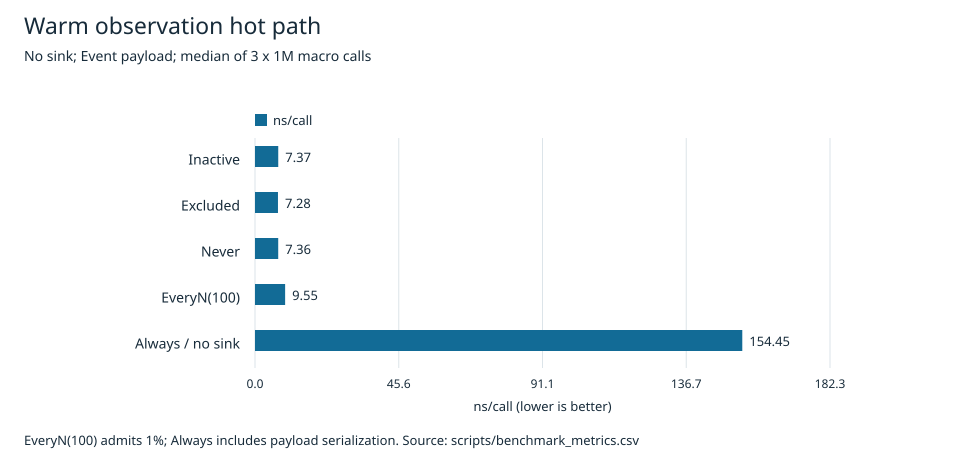

The recorded warm rejected path is about 7.3 ns/call. `EveryN(100)` mostly exercises rejection. An admitted sinkless Observation still serializes its payload, so “no sink” is not the same as disabled instrumentation.

### Scoped capture follows normal emission cost

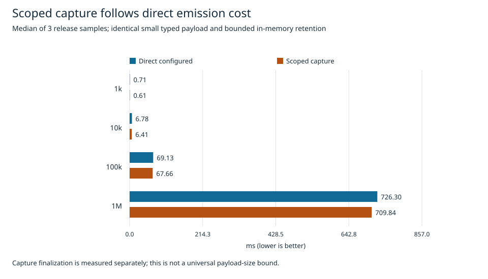

For the small two-field payload in the current capture dataset, scoped capture emission tracks an independently configured in-memory engine closely from 1k to 1M records. Capture finalization is measured separately; this is not a universal payload-size bound.

### Prepared evidence avoids repeated work

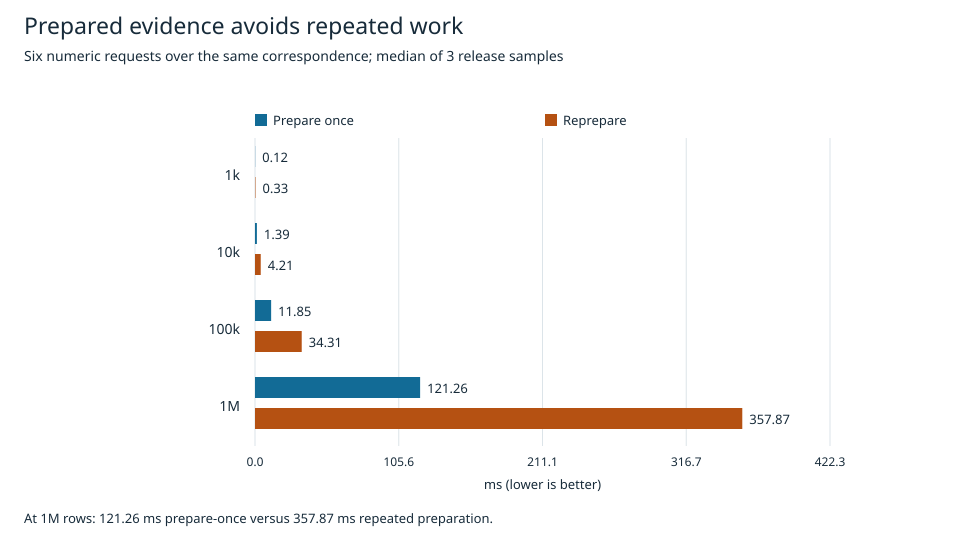

At 1M rows, six requests over one prepared correspondence took a 121.2639 ms median versus 357.8696 ms when keys, correspondence, and projections were rebuilt for every request. Prepared semantic views avoid repeating decode, alignment, and projection work.
### Typed decode performance

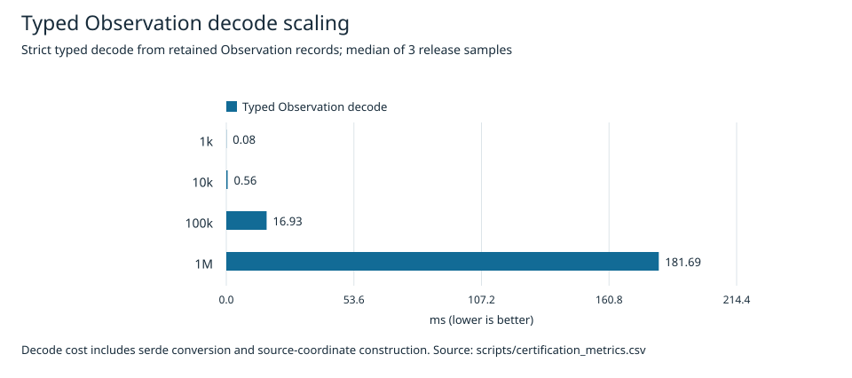

The retained certification benchmark measures strict typed decoding from 1k through 1M records, including filtering, Serde conversion, and source-coordinate construction.

### Lag search performance


The keyed Pearson benchmark shows that temporal analysis cost grows with both evidence size and the requested candidate window.
### Domain planning is frontier-bounded


For four active enum dimensions at budget 64, growing positive potential from 256 to 1,048,576 did not trigger eager Cartesian construction. Compile and bounded traversal remained in the same small-millisecond range for these fixtures.

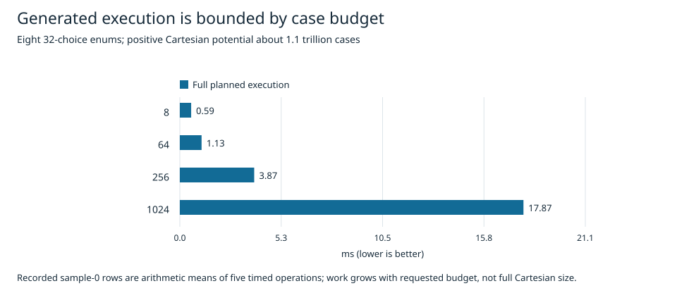

With eight 32-choice enums, the positive Cartesian potential is about 1.1 trillion combinations, yet full planned execution follows the requested case budget. This demonstrates bounded frontier exploration; it does **not** claim that arbitrary constraint solving is constant time. Constraint-heavy negative combinations can be substantially more expensive.

### Producer throughput is not persistence throughput

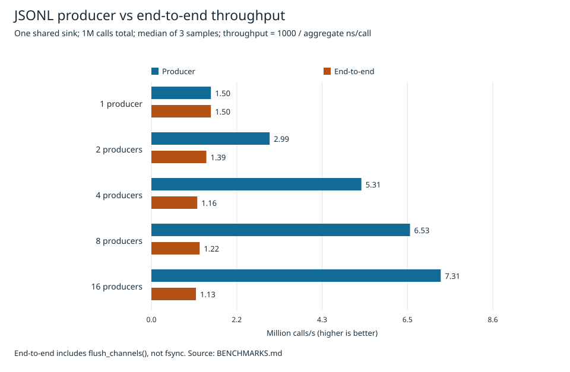

Multiple producers share one JSONL writer. Producer enqueue rate can improve while through-flush service remains bounded by that writer. Async sink queues are currently unbounded, so enqueue throughput is not bounded-memory or durable-storage throughput.

### Selector scale

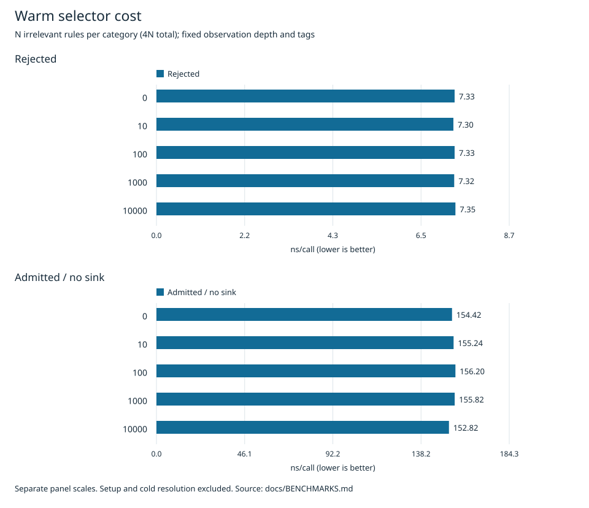

The warm selector path is measured through 10,000 irrelevant rules per category while namespace depth and Observation tags remain fixed. Setup and cold resolution are outside this chart.

### Sink topology

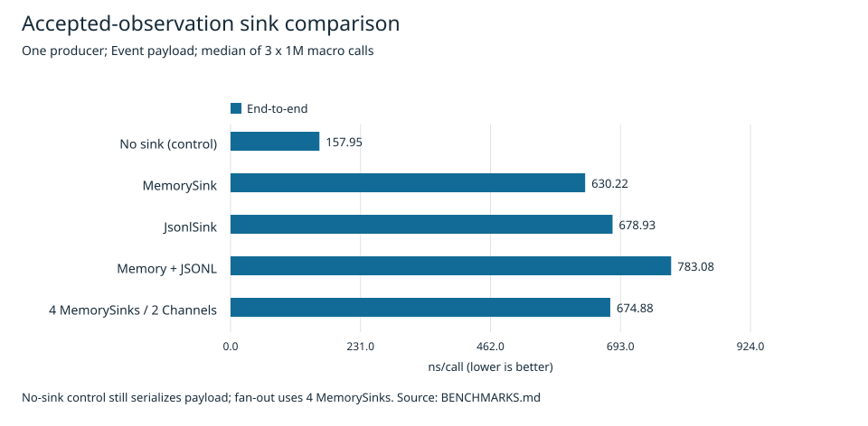

The no-sink control still serializes admitted payloads. Memory, JSONL, combined delivery, and fan-out measure different promised effects; the fan-out fixture uses four MemorySinks across two channels.

### Writer batching

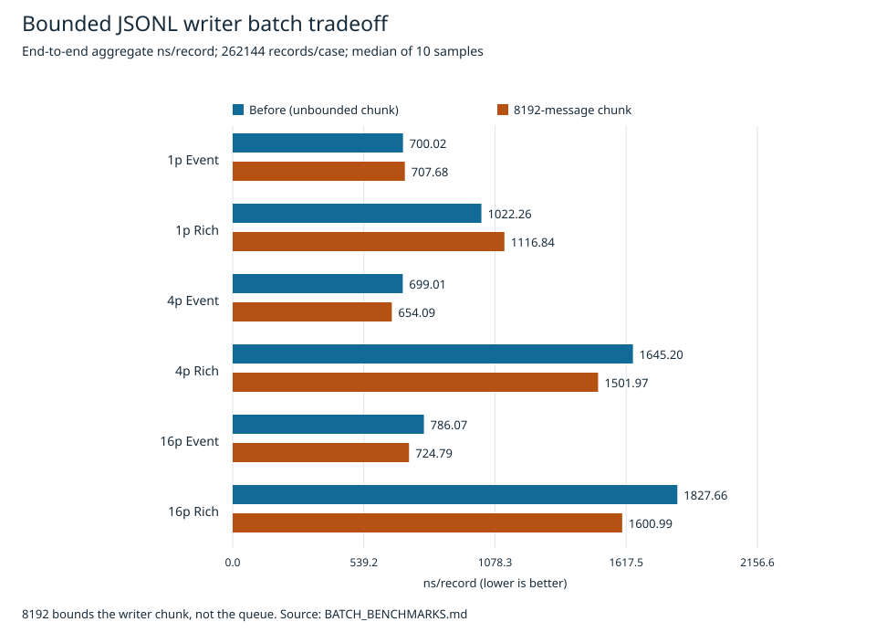

The bounded writer chunk helps saturated tracked cases but is not a universal speedup, queue backpressure, or a payload-size limit.

### Human rendering
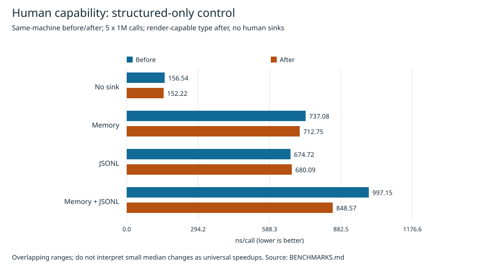

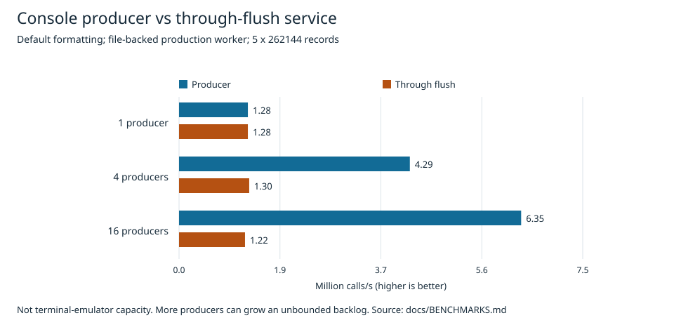

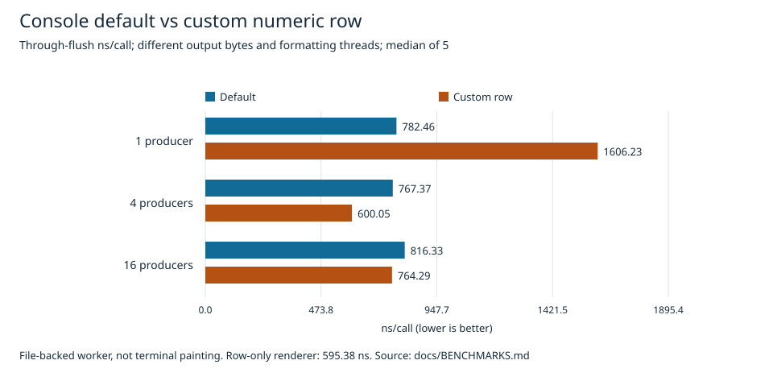
Human formatting is requested only by human sinks. Structured-only routes do not need human rendering. Console measurements use file-backed output rather than terminal painting, so a real terminal can be slower.

### Reproduce or verify the charts

~~~sh
python scripts/render_benchmark_charts.py
python scripts/render_benchmark_charts.py --check
~~~

Fresh measurement commands include:

~~~sh
cargo bench -p sun-observations --bench runtime
cargo bench -p sun-observations --bench batch
cargo bench -p sun-observations --bench human
cargo test -p sun-observations --release --bench capture -- --measure
cargo test --release -p sun-observations --bench generative_certifications -- --measure
~~~

The retained benchmark CSV files under `scripts/` are the measurement evidence; README charts are deterministic views of those datasets.

## How the framework fits together

| Namespace | Use it to… | Owns |
| --- | --- | --- |
| `sun_observations::certifications` | Prove contracts over ordinary values, collections, artifacts and references | Preparation, comparison, analysis, expectations, collect-all reports |
| `sun_observations` | Expose otherwise invisible production facts and measure lifecycles | Typed evidence, selection, scopes/policies, propagation, routing, sinks, spans |
| `sun_observations::evidence` | Turn production evidence into the same generic sources | Capture/completeness, snapshots, queries, strict decode, provenance |

There is **one certification system**, not a logging-specific parallel one. The
generic certification layer remains independent of runtime concepts and state;
the evidence adapter composes runtime and generic certification.

Choose your next task:

- [Certify values and collections](#certifications): exact invariants, comparison, statistics.
- [Expose production evidence](#observations): select, scope, route, propagate, profile.
- [Capture or load evidence](#capture-production-evidence): typed sources with provenance.
- [Common recipes](#cookbook), [production guarantees](#production-configuration-and-guarantees), or the [complete client API](#complete-client-dsl-and-api-reference).

## Certifications

### Facts, expectations and one proof boundary

```text
value / PreparedSource → Fact → expect → CheckResult → Certification::check
                                                        ↓
                                           CertificationReport → assert_certify()
```

Facts and analysis are neutral. `fact(name, value)` wraps ordinary evidence;
`try_fact(name, result)` preserves fallible preparation as evidence. `expect(...)`
returns a `CheckResult`, never an assertion or an intermediate panic. Plain values
mean equality; use standard expectations or one domain-owned `Expectation` for
more involved acceptance.

| CheckClass | Meaning |
| --- | --- |
| `Pass` | Accepted |
| `HardViolation` | Evaluated deterministic invariant failed |
| `StatisticalViolation` | Evaluated statistical/anomaly threshold failed |
| `EvaluationError` | Evidence/evaluation invalid, unavailable or incomplete |

**Every non-Pass fails the final proof.** Statistical violations are not warnings.
Undefined required metrics and invalid bounds fail closed, rather than becoming NaN
or silently passing. Scenario thresholds belong to expectations, not Observations.

`proof.section("meaning", |c| { ... })` groups independent checks into semantic paths.
Normal certification tests finish with `proof.assert_certify()`, the aggregated proof boundary.
`proof.report()` is reserved for programmatic/tooling inspection where a nonpanicking
`CertificationReport` is itself needed; do not replace the normal test assertion with manual
report checks. Do not unwrap acceptance midway: that loses collect-all diagnostics. Fallible
dependent preparation should become a failed check, while unrelated sections still run.

### Name sources and prove collection integrity

Use `source(name, &value)` for one value, `collection` or `proof.collection` for
rows. A singular `&Vec<T>` is one Vec value, not a row collection. Keep borrowed inputs alive.

```rust
use sun_observations::certifications::*;

let ids = [10u64, 11, 12];
let status = String::from("ready");
let mut proof = certification("published artifact");
let metadata = proof.source("status", &status);
let rows = proof.collection("artifact ids", &ids);
proof.check("ready", metadata.single_map(|s| s.clone()).expect("ready"));
proof.check("count", rows.count().expect(CountRule::Exact(3)));
proof.check("identity", rows.unique(|id| *id).expect_valid());
proof.check("no gaps", rows.contiguous(|id| *id, 10, 12).expect_valid());
proof.check("no forbidden id", rows.matching_count(|id| *id == 99).expect(0usize));
proof.assert_certify();
```

`expect_valid()` accepts structural reports, not a subjective quality score. For
structural row rules, count invalid rows and expect zero. `project` caches arbitrary
field projections; `numeric` caches an f64 per row for repeated analysis.

### Compare semantic entities, not arrival order

Prepare **domain-key correspondence** once, then reuse it across fields. Tuples or
dedicated key types express identity. Include execution identity when keys repeat
between runs; insertion/arrival order is not a cross-owner identity.

```rust
use sun_observations::certifications::*;

#[derive(Clone)]
struct Row { fold: u8, row: u64, label: u8, value: f64 }
let producer = [
    Row { fold: 0, row: 1, label: 1, value: 2.0 },
    Row { fold: 1, row: 1, label: 2, value: 4.0 },
    Row { fold: 0, row: 2, label: 3, value: 7.0 },
];
let consumer = [producer[2].clone(), producer[0].clone(), producer[1].clone()];
let mut proof = certification("producer to consumer");
let left = proof.collection("producer", &producer);
let right = proof.collection("consumer", &consumer);
let pair = left.compare_with(&right).on(|v| (v.fold, v.row), |v| (v.fold, v.row));
proof.check("exact unique keys", pair.paired_comparison_fact().expect_valid());
proof.check("labels preserved", pair.equal(|v| v.label, |v| v.label, 3).expect_valid());
proof.check("values preserved", pair.check_pairs(|a, b| a.value == b.value, 3).expect_valid());
proof.assert_certify();
```

Missing/duplicate keys are explicit; duplicates never form ambiguous pairs. Dependent
field/numeric checks on incomplete correspondence yield `EvaluationError`, not a
successful proof over the matched subset. The final argument to pair checks bounds
example diagnostics; it does not limit the rows checked.

### Prove numeric agreement, not just correlation

A perfect correlation can still hide an offset, wrong scale, wrong units, or stale
values. It does not prove equality or causality. Combine correspondence with the
metrics that express the actual contract:

```rust
use sun_observations::certifications::*;

let expected = [(1u64, 2.0), (2, 4.0), (3, 7.0)];
let actual = [(3u64, 7.000001), (1, 2.0), (2, 4.0)];
let mut proof = certification("numeric transfer");
let left = proof.collection("reference", &expected);
let right = proof.collection("optimized output", &actual);
let pair = left.compare_with(&right).on(|v| v.0, |v| v.0);
let values = pair.numeric(|v| v.1, |v| v.1);
proof.check("keys", pair.paired_comparison_fact().expect_valid());
proof.check("association", values.correlation().expect(CorrelationExpectation::spearman_at_least(0.99).unwrap()));
proof.check("scale", values.linear_fit().slope().expect(close_to(1.0).unwrap().absolute_tolerance(1e-5).unwrap()));
proof.check("fit", values.linear_fit().expect(
    LinearFitExpectation::slope_between(0.999, 1.001).unwrap()
        .and_intercept_between(-1e-5, 1e-5).unwrap().and_r_squared_at_least(0.99).unwrap(),
));
proof.check("direct error", values.difference().expect(
    DifferenceExpectation::max_absolute_at_most(1e-5).unwrap(),
));
proof.check("scalar tolerance", fact("total", 13.000001).expect(
    close_to(13.0).unwrap().absolute_tolerance(1e-5).unwrap().relative_tolerance(0.0).unwrap(),
));
proof.assert_certify();
```

`correlation()` exposes Pearson/Spearman; `linear_fit()` fits right on left and
exposes slope/intercept/R²/residuals; `difference()` measures **right minus left**,
not fitted residuals. Prepared numeric pairs cache projections and compact results
(including errors); requesting these views does not repeat decoding or correspondence.
The `unwrap()` calls above validate fixed scenario configuration, not acceptance.
For external configuration, handle builder errors explicitly. `close_to(x).unwrap()` accepts
`abs(actual-x) <= absolute + relative*abs(x)`; both defaults are `1e-9`.

### Inspect groups, anomalies and temporal lag

Global scores can hide broken partitions. Group by domain identity, then choose
scenario-owned thresholds. Outliers use robust MAD; jumps inspect **source order**,
so sort into domain time order first when arrival order is not meaningful.

```rust
use sun_observations::certifications::*;

let samples = [(0u8, 10.0), (0, 10.1), (0, 9.9), (1, 10.0), (1, 10.2), (1, 9.8)];
let mut proof = certification("sensor partitions");
let rows = proof.collection("samples in time order", &samples);
let groups = rows.group_by(|v| v.0);
proof.check("each sensor", fact("sensor summaries", groups.numeric(|v| v.1).summaries()).expect(
    GroupExpectation::new(3, 9.5, 10.5 ).unwrap(),
));
for group in groups.iter() {
    let values = group.numeric(|v| v.1);
    proof.section(format!("sensor {}", group.key), |c| {
        c.check("robust outliers", try_fact("sensor values", values.outliers(OutlierConfig::default()))
            .expect(AtMostAnomalies(0)));
        c.check("sudden jumps", try_fact("ordered sensor values", values.jumps(JumpConfig::new(Some(0.5), None, 1e-9).unwrap())).expect(AtMostAnomalies(0)));
    });
}
proof.assert_certify();
```

For unknown stale/off-by-one relations, search a bounded range of **temporal keys**,
not vector offsets. A positive lag `d` pairs left key `k` with right key `k+d`:

```rust
use sun_observations::certifications::*;

let sent = [(0i64, 2.0), (1, 9.0), (2, 3.0), (3, 7.0), (4, -1.0), (5, 5.0), (6, 11.0), (7, 4.0)];
let received: Vec<_> = sent.iter().map(|(key, value)| (key + 1, *value)).collect();
let mut proof = certification("known one-tick delay");
let left = proof.collection("sent", &sent);
let right = proof.collection("received", &received);
let delayed = left.compare_with(&right).on(|v| v.0 + 1, |v| v.0);
proof.check("exact known tick offset", delayed.paired_comparison_fact().expect_valid());
proof.check("payload preserved", delayed.equal(|v| v.1, |v| v.1, 3).expect_valid());
proof.check("delay", left.lag_with(&right, |v| *v, |v| *v, LagConfig {
    range: LagRange::new(-1, 1 ).unwrap(), measure: LagMeasure::Pearson,
}).expect(LagExpectation { best_lag: 1 }));
proof.assert_certify();
```

Use one unique temporal domain per search: partition repeated fold/target/execution
keys first. `LagAlignment` distinguishes expected boundary truncation from interior
gaps; no defined candidate or an interior-incomplete best alignment is an EvaluationError. A complete, defined alignment at the wrong best lag is a StatisticalViolation.
When offsets are known, prove them exactly too—lag is diagnosis, not a substitute for
causal identity; see the complete client API section below for correspondence, relation, and lag.

## Domain generation

A Domain describes **where a semantic contract must hold**. Checks describe **what must hold** after execution. Use a Domain when one semantic owner promises behavior over a family of inputs that the typed DSL can faithfully express.

Generate invalid states only against the owner that owns validation or rejection. A downstream owner that receives a validated type should be certified over the valid states that type can represent, not impossible raw states.

### Define a generated input

~~~rust
use sun_observations::certifications::*;

#[derive(Clone, DomainInput)]
enum Mode { Fast, Accurate }

#[derive(Clone, DomainInput)]
struct Request {
    mode: Mode,
    window: usize,
    values: Vec<f64>,
}
~~~

The derive supports concrete named structs/enums plus integer primitives, `f32`, `f64`, `bool`, `String`, and `Vec<T: DomainInput>`. Generic input types are not supported by the derive.

### Constructive value spaces

Every active field needs one constructive specification.

~~~rust
use sun_observations::certifications::*;

#[derive(Clone, DomainInput)]
struct Input {
    exact: u8,
    choice: i32,
    bounded: i64,
    split: i64,
}

let domain = domain!(Input {
    exact.fixed_value(7),
    choice.selected_values([-1, 0, 3]),
    bounded.in_range(-10..=10),
    split.one_of_ranges([-100..=-90, 90..=100]),
});
~~~

`fixed_value` gives one constructive value. `selected_values` gives an explicit finite set. `in_range` describes one ordered interval. `one_of_ranges` preserves disconnected branches rather than flattening their gaps.

`String` currently uses fixed/selected values; there is no general regex or arbitrary-string generator.

### Enums and payloads

~~~rust
use sun_observations::certifications::*;

#[derive(Clone, DomainInput)]
enum Strategy {
    Direct,
    Window { size: usize },
}

#[derive(Clone, DomainInput)]
struct Input { strategy: Strategy }

let domain = domain!(Input {
    strategy {
        all_enum_values(),
        Strategy::Window {
            size.in_range(1..=8)
        }
    }
});
~~~

`all_enum_values()` or `selected_enum_values(...)` chooses variants. Payload fields still need their own constructive rules inside the variant block.

### Conditions

~~~rust
use sun_observations::certifications::*;

#[derive(Clone, DomainInput, PartialEq)]
enum Mode { Fast, Accurate }

#[derive(Clone, DomainInput)]
struct Input { mode: Mode, window: usize }

let domain = domain!(Input {
    mode.all_enum_values(),
    when(mode.equal(Mode::Fast)) {
        window.in_range(1..=3)
    },
    when(mode.equal(Mode::Accurate)) {
        window.in_range(4..=8)
    },
});
~~~

Conditional rules are typed. Missing, overlapping, contradictory, or unmaterializable active construction fails closed before generated execution.

### Collections

~~~rust
use sun_observations::certifications::*;

#[derive(Clone, DomainInput)]
struct Input { values: Vec<i32> }

let domain = domain!(Input {
    values {
        length().in_range(1..=8),
        each(in_range(-10..=10))
    }
});
~~~

For structured elements, use `each { ... }` and ordinary nested rules. Collection length is itself a typed `usize` field and can participate in relations.

### Relations

The DSL supports `equal`, `not_equal`, `less_than`, `less_equal`, `greater_than`, and `greater_equal`.

~~~rust
use sun_observations::certifications::*;

#[derive(Clone, DomainInput)]
struct Window { start: i64, end: i64 }

let domain = domain!(Window {
    start.in_range(0..=100),
    end.in_range(0..=100),
    start.less_equal(end),
});

~~~

At a validation boundary the runner can explore both satisfying and constraint-breaking representatives. At a downstream validated boundary, describe only reachable valid states.

### Concrete cases plus Domain

A strong owner certification often combines both:

~~~rust
use sun_observations::certifications::*;

#[derive(Clone, DomainInput)]
struct Input { value: i32 }

fn reciprocal(input: &Input) -> Result<f64, &'static str> {
    if !(1..=100).contains(&input.value) { return Err("invalid denominator"); }
    Ok(1.0 / f64::from(input.value))
}
let mut proof = certification("positive reciprocal inverts scale").executor(reciprocal);

proof.data_source([Input { value: 17 }]);
proof.domain(domain!(Input { value.in_range(1..=100) }));

let case = proof.case();
proof.check(fact!(*case.result() * f64::from(case.input().value))
    .expect(close_to(1.0).unwrap().absolute_tolerance(1e-12).unwrap()));
proof.assert_certify();
~~~

Keep a concrete case when it has independent regression, fixture, boundary, or diagnostic meaning. Do not manually enumerate ordinary boundaries that the Domain already expresses.

## Observations

### Define semantic evidence

Choose a stable namespace for meaning, not the Rust module/type spelling. Tags select
cross-cutting facets such as `evidence`, `diagnostic` or `expensive`; they are not
persisted. Namespace segments and individual tags use `[a-z][a-z0-9_]*`.

```rust
use serde::Serialize;
use sun_observations::{observe, start_scope, Observation, ScopeConfig};

#[derive(Serialize, Observation)]
#[observation(namespace = "encoder::train::epoch", level = INFO, tags("diagnostic"))]
struct Epoch { epoch: usize, loss: f64 }
let _scope = start_scope(ScopeConfig::new("training-42").activate_namespace("encoder::train").unwrap());
observe!(Epoch { epoch: 1, loss: 0.125 });
```

Payloads require `Serialize + 'static`; add `Deserialize` to decode captured evidence.
Level defaults to INFO; WARN/ERROR are severity, never selection bypasses. Put expensive
construction **inside** `observe!` or `try_observe!` so rejection skips
construction, serialization, message and rendering. Admitted sinkless calls still
serialize and call `message()`: no destination is not disabled instrumentation.

`observe!(value)` returns `()` for ordinary best-effort production side effects; no
`let _ =`, `?`, or result handling is needed. Use `try_observe!(value)` when admission
or emission errors must be caller-visible: it returns `Result<bool, ObservationError>`.
Both macros share the canonical runtime path. Ignored errors still affect capture
completeness and runtime health accounting; best-effort does not mean guaranteed delivery.

### Select what is active

| Control | Question |
| --- | --- |
| Selection | **Whether** this type is active |
| Scope | **Which execution** owns it |
| Routing | **Where** it goes |
| Policy | **How often** selected occurrences are admitted |

```rust
use sun_observations::{global, Selection};
global().set_selection(Selection::new()
    .activate_namespace("service").unwrap()
    .activate_tags(["production"]).unwrap()
    .exclude_namespace("service::wire").unwrap()
    .exclude_tags(["expensive"]).unwrap());
```

Defaults activate nothing. Global and current-scope positives union (namespace OR
tag); **either exclusion vetoes**. A scope cannot undo a global exclusion. `set_selection`
replaces, not merges. Namespace selectors/routes match segment-aware subtrees:
`service::job` includes its descendants, not `service::jobs`. Routing never activates.
Validate external selector strings before builders; invalid selectors panic, whereas
`register_namespace_channel` returns an error.

### Scope and limit high-rate evidence

```rust
use serde::Serialize;
use sun_observations::{observe, start_scope, Observation, Policy, ScopeConfig};

#[derive(Serialize, Observation)]
#[observation(namespace = "encoder::train::batch")]
struct Batch { index: usize, norm: f64 }
fn compute_norm() -> f64 { 0.125 }
let _scope = start_scope(ScopeConfig::new("training-42")
    .activate_namespace("encoder::train").unwrap()
    .override_policy::<Batch>(Policy::every_n(100).unwrap()));
for index in 1..=200 {
    observe!(Batch { index, norm: compute_norm() });
}
```

Only occurrences 100 and 200 construct the payload here. Default `Always` admits
every selected occurrence; `Never` none, `FirstN(n)` the first n,
`EveryN(n)` the n-th, 2n-th, …; both variants require NonZeroU64. Budgets belong to **scope
instance + concrete type**, shared by propagated workers. They count admitted
attempts, not durable writes; failed serialization/delivery still consumes admission.

Keep the scope guard alive. Nested scopes have fresh selectors/policies/counters,
not inherited local configuration; dropping restores the predecessor. Reusing a
scope name does not reuse a budget, but makes persisted execution identity ambiguous.

### Propagate execution context

```rust
use sun_observations::certifications::{certification, fact};
use sun_observations::{context, start_scope, Context, ScopeConfig};

let _scope = start_scope(ScopeConfig::new("request-42"));
let captured = Context::capture();
let worker = context::thread::spawn(|| Context::capture().scope_name().map(str::to_owned));
let child_scope = worker.join().expect("worker panicked");
let installed = captured.run(|| Context::capture().scope_name().map(str::to_owned));
certification("execution identity")
    .check("child", fact("worker scope", child_scope).expect(Some(String::from("request-42"))))
    .check("captured", fact("installed scope", installed).expect(Some(String::from("request-42"))))
    .assert_certify();
```

`Context::capture()` plus `enter()`/`run()` installs execution state at an existing
worker boundary; guard drop restores it. `Context::default()` is explicitly empty.
Plain OS threads and async tasks do **not** inherit context. Join workers and propagate
their failures; do not hold thread-local guards across async suspension/migration.

With the built-in Rayon integration, `context::rayon::ContextThreadPool::with_threads(std::num::NonZeroUsize::new(4).unwrap())?` binds
the context **at construction**, including nested jobs; `pool.install(|| work())` does
not adopt a later caller's context. Build a pool for each intended execution boundary.
See executable [threads](../../crates/sun-observations/examples/threads.rs) and [Rayon](../../crates/sun-observations/examples/rayon.rs) workflows.

### Route, retain and persist

Configure global delivery once at application startup. Share one sink per physical
destination. Channels are logical destinations, not namespaces or persisted fields.

```rust,no_run
use serde::Serialize;
use std::sync::Arc;
use sun_observations::*;

#[derive(Serialize, Observation)]
#[observation(namespace = "service::request", tags("production"))]
struct Request { path: &'static str, status: u16 }

let engine = global();
let memory = Arc::new(MemorySink::new());
let file = Arc::new(JsonlSink::with_config("observations.jsonl",
    JsonlConfig::new().flush_interval_ms(1000).unwrap().max_file_size_mb(10).unwrap().trim_fraction(0.10).unwrap())?);
engine.add_channel_sink("operations", memory.clone());
engine.add_channel_sink("operations", file.clone());
engine.add_channel_sink("operations", Arc::new(ConsoleSink::stderr()));
engine.register_namespace_channel("service", "operations")?;
engine.set_selection(Selection::new().activate_namespace("service").unwrap());
let emission = try_observe!(Request { path: "/health", status: 200 });
let persistence = engine.flush_channels();
emission?;
persistence?;
let snapshot = memory.shared_records();
# let _ = snapshot;
# Ok::<(), Box<dyn std::error::Error>>(())
```

- **MemorySink** is synchronous bounded history (default 1,000,000 records / 10%
  oldest-batch eviction). Shared snapshots retain records after drain/eviction;
  use scoped capture, not an unchecked memory subset, for proofs.
- **JsonlSink** asynchronously appends structured JSONL. `open_append(path)?` has no size
  limit; file retention removes whole oldest records toward the configured target.
  `max_file_size_mb` means MiB; an oversized newest record remains whole. Parents must
  exist; constructor success validates config, not asynchronous file access.
- **ConsoleSink** asynchronously writes human output to stdout/stderr or an owned
  writer. Structured Memory/JSONL never request human rendering.

Overlapping namespace routes fan out. Routes to the same channel deduplicate; the
same sink on different matching channels intentionally receives duplicate deliveries.
All targets are attempted on failure; there is no cross-sink rollback or total order.

`Ok(true)` from `try_observe!` means admitted/dispatched (possibly sinkless); for async
sinks it means **enqueue**, not persistence. Flush is a queue-prefix error barrier,
**not fsync**. Evaluate the barrier even after emission failure, as above; report
both errors if both fail. JSONL/Console queues are unbounded and failures sticky,
with no retry. Global statics are not dropped at exit: explicit shutdown matters.
See [production configuration and guarantees](#production-configuration-and-guarantees) for retention, errors, custom sinks, and shutdown.

### Render human output without changing evidence

Implement the trait manually when you need a persisted `message()` or transient
`render_text()`. Serde `data` remains canonical:

```rust
use serde::Serialize;
use sun_observations::Observation;
#[derive(Serialize)]
struct Epoch { epoch: u64, loss: f64 }
impl Observation for Epoch {
    const NAMESPACE: &'static str = "encoder::train::epoch";
    fn render_text(&self) -> Option<String> {
        Some(format!("{:>5} | {:8.4}", self.epoch, self.loss))
    }
}
```

Rendering runs once on the producer only when a routed human sink requests it;
multiple human sinks share the text. It is literal/multiline output, not persisted
data. `None` uses Console's envelope/message/data fallback. Tables are independent
header/row/footer point Observations, not spans: see [human.rs](../../crates/sun-observations/examples/human.rs).

### Measure lifecycles with spans

```rust
use serde::Serialize;
use sun_observations::{observe_span, start_scope, Observation, ScopeConfig};
#[derive(Serialize, Observation)]
#[observation(namespace = "encoder::fit")]
struct Fit { samples: usize }
let _scope = start_scope(ScopeConfig::new("fit-42").activate_namespace("encoder").unwrap());
let span = observe_span!(Fit { samples: 128 })?;
// Run the operation while the guard is alive.
span.finish()?;
# Ok::<(), sun_observations::ObservationError>(())
```

One admission produces start with payload and end with null data. Explicit `finish()`
reports end errors; normal Drop also ends, but cannot return errors. Scope/routes/sinks
freeze at start. Rejection builds nothing. Abort, leaks, I/O failure and retention can
leave incomplete pairs. Spans do not invoke point renderers or imply a parent tree.

Pair by `(proc, scope, namespace, span)`, never adjacency; duration is end minus start
`proc_ns`, not wall-clock `ts`. Do not combine elapsed clocks across engines or sum
overlapping intervals as disjoint work. Nanosecond units retain available monotonic precision, not nanosecond hardware resolution; clock/instrumentation noise remains. See [FORMAT v1](../../docs/FORMAT.md#lifecycle-and-timing) and [typed span evidence](#span_evidence).

## Capture production evidence

Capture in the tour runs the **real production call** and preserves its result in
`CapturedRun<T>`. Keep/reuse a `TypedView`: each `to_typed::<T>()` call decodes again.
Its `source(name)` is the same generic `PreparedSource` used for ordinary values,
with optional original-record provenance in bounded diagnostics.

Capture selection replaces global admission/delivery **inside the captured context**
without mutating shared configuration. Scope policy/local exclusions still apply.
Parallel captures isolate storage; nested captures are **exclusive** (inner evidence
is absent from outer). Child scopes inherit attachment, and explicit Context/thread/
Rayon propagation carries it. Finish spans and join/drop propagated owners inside
the closure; escaped owners make completeness unprovable even before late emission.
Panic unwinding restores context, but the panic propagates.

`run.dataset()` is a fixed snapshot. For persisted or existing memory evidence,
construct an `ObservationDataset`, query envelope fields, then strictly decode:

```rust
use serde::{Deserialize, Serialize};
use sun_observations::{MemorySink, Observation};
use sun_observations::evidence::{ObservationsQuery, ObservationDataset};
#[derive(Serialize, Deserialize, Observation)]
#[observation(namespace = "jobs::completed")]
struct Completed { job: u64 }
let memory = MemorySink::new();
let dataset = ObservationDataset::try_from_memory(&memory).unwrap();
let selected = dataset.query(ObservationsQuery::new().namespace_subtree("jobs").scope("run-42"));
let completed = selected.to_typed::<Completed>()?;
let source = completed.source("completed jobs");
# let _ = source;
# Ok::<(), Box<dyn std::error::Error>>(())
```

This example shows selection over an existing sink; an empty snapshot proves no
production effect. Snapshot membership is fixed, not proof of complete retention.
For captures, **always start with `run.certification`**. For external files, establish
completeness through the artifact's own contract before making absence/count claims.
Load JSONL fallibly (`BufRead::lines` → deserialize `ObservationRecord` → `Arc` →
`try_from_records`); never discard malformed lines. Strict typed decoding includes matching
points/span starts and skips ends, not malformed matching payloads.

Filter `proc`/`scope` before comparing repeated execution keys, or include execution
identity in keys. Source indices are source-local; original coordinates are available
through `typed.sources()[index]`. See the [capture tutorial](#capture-production-evidence).

## Certification methodology

### Certification only vs certification + Observations

Use certification alone when canonical inputs, returns, artifacts, or promised external state expose enough evidence. Add Observations when a proof-critical semantic fact disappears inside the real production pipeline.

- **Boundary Observation** records a meaningful transfer between owners or stages.
- **Decision Observation** records a domain-significant accept/reject/select/suppress branch.
- **Diagnostic Observation** records a metric or state needed by a concrete certification or diagnostic workflow.

Observations record facts. Certifications own expectations and pass/fail policy. Do not emit an Observation that merely duplicates an already canonical result.

### Must happen and must never happen

A strong failure-path proof is usually stronger than checking only `Result::is_err()`. When semantically promised, prove the rejection owner/category, absence of prohibited downstream effects, promised cleanup/state, and an independent healthy path.

### Identity, causality, oracle, and controls

Join by explicit domain identity, not vector index, sink order, or formatted field names unless that ordering is contractual. Value agreement does not prove causality: certify row identity, timestamp, horizon, or decision-entry offsets explicitly when they are known.

For optimized or mathematically complex behavior, prefer an independent oracle using a meaningfully different implementation path. When exact expected output is awkward, use a known metamorphic relation such as positive scaling, sign reversal, translation invariance, partition invariance, or a null/control scenario.

### Migrating a single-case test

Choose among four outcomes:

- **Concrete case only** for a historical regression, exact fixture, meaningful boundary, or external scenario.
- **Concrete case + Domain** when the example stays valuable but the same rule is family-wide.
- **Domain only** when the old example was arbitrary and has no independent meaning.
- **Remove** when another certification already proves the same semantic contract without losing diagnostic value.

If one arbitrary example stands in for a family-wide contract, Domain must be considered. Invalid generation belongs to the owner that validates or rejects those states; downstream validated owners receive only reachable valid inputs.

## How Domain generation works internally

This section explains implementation strategy so users can reason about coverage and cost. These planner concepts are **not** the normal client API; application code should use `DomainInput`, `domain!(...)`, runner controls, and checks.

### Compile into a typed constraint model

Before generated execution, the framework compiles the Domain into typed variables, constructive value spaces, conditional contexts, relation constraints, enum coverage catalogs, collection-composition targets, and positive/negative target frontiers. Invalid or unmaterializable specifications fail before generated execution instead of silently dropping rules.

### Representative range anchors

An ordered range is not represented by one random value. The compiler derives deterministic representatives including outer endpoints, a center across disconnected ranges, branch endpoints, boundaries around low/middle/high thirds where representable, and interior representatives. Real-valued ranges use analogous interpolation.

`one_of_ranges(...)` preserves each disconnected branch. Gaps become distinct invalid regions rather than one generic “outside” bucket.

### Negative sectors

Constructive rules define valid space and also allow representative invalid sectors when the underlying type can represent them.

Ranges can produce near/middle/far values below or above the valid range and inside disconnected gaps. Explicit selections can produce nearby/outside alternatives. Enum selections can produce excluded variants. Relations carry their own violation identity.

The planner explores single-constraint negatives before selected simultaneous negative pairs. Therefore `failure_budget` tracks representative semantic failures, not simply the first N rejected calls.

### Enum coverage without eager Cartesian expansion

Enum choices have stable coverage slots. The planner covers useful individual anchors, then feasible pairwise combinations, then higher-order combinations when budget remains. Conditional branches contribute only combinations feasible in that active context.

`require_pairwise_coverage()` turns feasible enum-value and pair coverage into a required proof result. It does not allocate the full product and does not increase the case budget.

### Collection compositions

Collections are not represented only by one repeated element. Depending on the declared element space and available budget, generation can cover representative lengths, uniform anchors, mixed pair compositions, spread compositions, and nested structured elements. Collection length is a typed scalar and can participate in relations.

### Real data executes first

`data_source(...)` inputs run before generated cases. With a Domain, those real inputs are classified into the same semantic coordinate system and prefill already-covered slots.

This keeps historical regressions explicit while avoiding generated work that merely repeats their coverage.

### Breadth before depth

After deterministic anchors, remaining ordered-range exploration is stratified. Range branches are divided into low/middle/high regions and smaller strata. The framework seed deterministically permutes candidate strata and derives local seeds from semantic coordinate identity, so exploration spreads across the space before repeatedly deepening one small region.

### Case-local seeds

`executor_with_seed` receives a deterministic seed derived from certification identity plus case identity. Generated seeds are tied to canonical Domain coordinates; concrete seeds are tied to registered `data_source` ordinals. Adding unrelated generated executions does not intentionally redefine an existing case seed.

### Coverage categories and budgets

Generated execution conceptually progresses through:

1. positive anchors, enum combinations, collection compositions, and bounded free exploration;
2. single-constraint negative representatives;
3. selected multi-negative combinations.

Unused capacity can be redistributed when a category exhausts. `cases_budget` bounds generated exploration; mandatory concrete inputs may execute in addition. `failure_budget` may stop further materialization/execution once enough distinct failure representatives have been retained.

### Why huge Domains stay bounded

A Domain can describe a huge theoretical product without materializing all combinations. The retained benchmark with eight 32-choice enums describes about 1.1 trillion positive combinations, while a budget of 64 executes only a bounded frontier.

This is a bounded/lazy exploration guarantee, **not** a claim that all constraint solving is constant-time. Highly coupled negative constraints can require substantially more search than independent ranges.

### Classification verifies generation

Every materialized input is projected back into Domain coordinates. Generated coverage is counted from the resulting semantic classification, not merely from what the planner intended to create. A target that cannot be faithfully materialized is infeasible or fails closed rather than becoming false coverage.

### Current generation limits

The current DSL intentionally does not provide shrinking, arbitrary regex/string generation, maps/sets, general collection uniqueness constraints, arbitrary collection-order constraints, or unrestricted predicate constraints. Keep such cases as concrete fixtures or validate them at the semantic owner until they have a typed first-class representation.

## Complete client DSL and API reference

This is one embedded proof/evidence language: bind evidence, choose acceptance, optionally execute an input family, and assert once. Domain describes inputs; Observations expose production facts; certifications own analysis and acceptance. The compact agent skills use the same nodes and grammar. This reference adds types, failure semantics, caching, and extended examples; the [mental model](#how-the-framework-fits-together), [methodology](#certification-methodology), and [internals](#how-domain-generation-works-internally) remain the conceptual handbook.

### DSL

LAG_START/LAG_END/OFFSET are i64, while SEQUENCE_START/SEQUENCE_END are u64. SCALAR_TYPE is a built-in scalar DomainInput; WRITER is an owned Write + Send + 'static value. Uppercase words are nodes or parameters, not Rust identifiers to import. Parenthesized alternatives describe a choice of real calls, not a method literally named after the alternative. Use Rust closures for projections, predicates, and section bodies.

#### Certification grammar

~~~text
CERTIFICATION :=
    c = certification(NAME)
    [ SOURCE_BINDING ]*
    [ EAGER_CHECK | SECTION ]*
    ( ASSERT_CERTIFY
    | runner = c.executor(EXECUTOR); PLANNED_BODY
    | runner = c.executor_with_seed(SEEDED_EXECUTOR); PLANNED_BODY )
SOURCE_BINDING :=
    value = source(NAME, &VALUE) | rows = collection(NAME, &VALUES)
EAGER_CHECK :=
c.check_fact_expect(NAME, OBSERVED, EXPECTATION)
| c.check(NAME, FACT.expect(EXPECTATION))
| c.check(NAME, PREPARED_SOURCE_CHECK | NUMERIC_CHECK | GROUP_CHECK
| CORRESPONDENCE_CHECK | NUMERIC_COMPARISON_CHECK)
SECTION :=
    c.section(NAME, |s| { [ EAGER_CHECK | SECTION ]* })
  | runner.section(NAME, |s| { [ PLANNED_CHECK | AGGREGATE_CHECK | SECTION ]* })
PLANNED_BODY :=
    [ runner.data_source(INPUTS) ] [ runner.domain(DOMAIN) ]
    [ runner.cases_budget(N) ] [ runner.failure_budget(N) ]
    [ runner.seed(N) ] [ runner.report_mode(BOOL) ]
    [ runner.require_pairwise_coverage() ]
    [ CASE ] [ CASE_AGGREGATE ] [ PLANNED_CHECK | AGGREGATE_CHECK | SECTION ]* ASSERT_CERTIFY
CASE := case = runner.case()
CASE_AGGREGATE := cases = runner.case_aggregate()
PLANNED_CHECK :=
    runner.check(fact!(CASE_EXPRESSION).expect(EXPECTATION | fact!(CASE_EXPECTATION))
                 [ .description(TEXT) ])
  | runner.check(EAGER_CHECK_RESULT)
AGGREGATE_CHECK :=
    runner.check_aggregate(fact!(AGGREGATE_EXPRESSION)
        .expect(EXPECTATION | fact!(AGGREGATE_EXPECTATION)) [ .description(TEXT) ])
FACT := fact(SOURCE, VALUE) | try_fact(SOURCE, RESULT) | fact!(EXPRESSION)
EXPECTATION :=
    VALUE | NotEqual(VALUE)
  | Criterion::greater_than(BOUND)? | Criterion::at_least(BOUND)?
  | Criterion::less_than(BOUND)? | Criterion::at_most(BOUND)? | Criterion::between(MIN, MAX)?
  | criterion(TEXT, CLASS, PREDICATE)
  | close_to(VALUE)? [ .absolute_tolerance(ABS)? ] [ .relative_tolerance(REL)? ]
  | CountRule::NonEmpty | NumericRule::Finite | NumericRule::Positive | NumericRule::NonNegative
  | NumericRule::between(MIN, MAX)? | AtMostAnomalies(N) | LagExpectation { best_lag: OFFSET }
  | GroupExpectation::new(MIN_COUNT, MIN_MEAN, MAX_MEAN)?
  | CORRELATION_EXPECTATION | LINEAR_FIT_EXPECTATION | DIFFERENCE_EXPECTATION | RELATION_EXPECTATION
PREPARED_SOURCE_CHECK :=
    rows.count().expect(EXPECTATION) | value.single_map(PROJECT).expect(EXPECTATION)
  | rows.matching_count(PREDICATE).expect(EXPECTATION)
  | rows.unique(KEY).expect_valid() | rows.contiguous(KEY, SEQUENCE_START, SEQUENCE_END).expect_valid()
NUMERIC_CHECK :=
rows.numeric(PROJECT).expect(NUMERIC_RULE)
| rows.numeric(PROJECT).(summary() | robust_summary() | quantile(Q)).expect(EXPECTATION)
| rows.numeric(PROJECT).outliers(OutlierConfig::default()
| OutlierConfig::new(THRESHOLD, ZeroMadPolicy::ExactMedian
| ZeroMadPolicy::absolute_tolerance(ABSOLUTE_TOLERANCE)?)?).expect(AtMostAnomalies(N))
| rows.numeric(PROJECT).jumps(JumpConfig::new(ABSOLUTE_THRESHOLD, RELATIVE_THRESHOLD,
DENOMINATOR_FLOOR)?).expect(AtMostAnomalies(N))
| rows.(lag_self(PROJECT, LagConfig { range: LagRange::new(LAG_START, LAG_END)?,
measure: LagMeasure::Pearson | LagMeasure::Spearman })
| lag_with(&OTHER, LEFT, RIGHT, LagConfig { range: LagRange::new(LAG_START, LAG_END)?,
measure: LagMeasure::Pearson | LagMeasure::Spearman }))
.expect(LagExpectation { best_lag: OFFSET })
GROUP_CHECK :=
    fact(NAME, rows.group_by(KEY).numeric(PROJECT)
        .(summaries() | summaries_with_robust())).expect(GROUP_EXPECTATION)
CORRESPONDENCE_CHECK :=
paired = left.compare_with(&right).on(LEFT_KEY, RIGHT_KEY)
| paired.paired_comparison_fact().expect_valid()
| paired.equal(LEFT, RIGHT, TOP).expect_valid()
| paired.check_pairs(PREDICATE, TOP).expect_valid()
NUMERIC_COMPARISON_CHECK :=
    paired.numeric(LEFT, RIGHT).correlation().expect(CORRELATION_EXPECTATION)
  | paired.numeric(LEFT, RIGHT).linear_fit().expect(LINEAR_FIT_EXPECTATION)
  | paired.numeric(LEFT, RIGHT).difference().expect(DIFFERENCE_EXPECTATION)
  | paired.numeric(LEFT, RIGHT).relation().expect(RELATION_EXPECTATION)
ASSERT_CERTIFY := c.assert_certify() | runner.assert_certify()
~~~

#### Domain grammar

~~~text
DOMAIN := domain!(TYPE { RULE, ... }) | domain!(SCALAR_TYPE { CONSTRUCTIVE })
RULE := FIELD.CONSTRUCTIVE | FIELD { RULE, ... }
      | ENUM_RULE | COLLECTION_RULE | WHEN | RELATION
CONSTRUCTIVE := fixed_value(VALUE) | selected_values(VALUES)
              | in_range(RANGE) | one_of_ranges(RANGES)
              | all_enum_values() | selected_enum_values(VALUES)
ENUM_RULE := ENUM_FIELD {
    all_enum_values() | selected_enum_values(VARIANTS),
    EnumType::Variant { RULE, ... }, ...
}
COLLECTION_RULE := COLLECTION {
    length().(fixed_value(N) | selected_values(LENGTHS) | in_range(RANGE) | one_of_ranges(RANGES)),
    each(CONSTRUCTIVE) | each { RULE, ... }
}
WHEN := when(RELATION) { RULE, ... }
RELATION := FIELD.(equal(OPERAND) | not_equal(OPERAND)
                 | less_than(OPERAND) | less_equal(OPERAND)
                 | greater_than(OPERAND) | greater_equal(OPERAND))
~~~

#### Observation grammar

~~~text
DECLARATION :=
    #[derive(Serialize, Deserialize, Observation)]
    #[observation(namespace = NAMESPACE, level = LEVEL, tags(TAG, ...))]
    struct PAYLOAD { FIELDS }
EMISSION := observe!(VALUE) | try_observe!(VALUE)
SELECTION := Selection::new()
    [ .activate_all() | .activate_namespace(NS)? | .activate_tags(TAGS)? ]*
    [ .exclude_namespace(NS)? | .exclude_tags(TAGS)? ]*
SCOPE := guard = start_scope(ScopeConfig::new(NAME)
[ .selection(SELECTION) ]
[ .activate_all() | .activate_namespace(NS)? | .activate_tags(TAGS)?
| .exclude_namespace(NS)? | .exclude_tags(TAGS)? ]*
[ .override_policy::<PAYLOAD>(POLICY) ])
[ Context::capture().run(OPERATION) | context::thread::spawn(OPERATION) ]
ROUTING := engine.add_channel_sink(CHANNEL_NAME, SINK)
engine.register_namespace_channel(NAMESPACE, CHANNEL_NAME)?
SINK := Arc::new(MemorySink::new() | MemorySink::with_config(MEMORY_CONFIG)
| JsonlSink::open_append(PATH)? | JsonlSink::with_config(PATH, JSONL_CONFIG)?
| ConsoleSink::stdout() | ConsoleSink::stderr() | ConsoleSink::new(WRITER) | CUSTOM_SINK_IMPL)
SPAN := span = observe_span!(START_PAYLOAD)
OPERATION
span.finish()?
CAPTURE := run = capture_observations(CaptureConfig::new()
[ .selection(SELECTION) ]
[ .activate_all() | .activate_namespace(NS)? | .activate_tags(TAGS)?
| .exclude_namespace(NS)? | .exclude_tags(TAGS)? ]*
[ .retention(MEMORY_CONFIG) ], OPERATION)
QUERY := dataset.query(ObservationsQuery::new()
[ .namespace(NS) | .namespace_subtree(NS) ]
[ .scope(NAME) | .without_scope() ] [ .level(LEVEL) ]
[ .points() | .span_starts() | .span_ends() ] [ .span(ID) ] [ .process(ID) ])
TYPED_EVIDENCE := typed = (run | dataset | QUERY).to_typed::<PAYLOAD>()?; typed.source(NAME)
SPAN_EVIDENCE := spans = (run | dataset | QUERY).to_spans::<PAYLOAD>()?; spans.source(NAME)
~~~

### Certification language

#### CERTIFICATION

`certification(name)` constructs a named `Certification`. It can immediately evaluate checks, bind reusable sources, and group prerequisites. Only after those steps, if repeated execution is needed, consume it with `executor(f)` or `executor_with_seed(f)`. Both transitions preserve the eager proof. There is not a separate proof object to reconstruct or a second assertion to remember.

Names describe a semantic promise, not a function's implementation. Evidence sources borrow their values independently of the certification, so consuming `c` does not invalidate prepared bindings. The proof must not outlive borrowed evidence.

`limits(DiagnosticLimits { failures, bytes_per_failure })` bounds eager retained/rendered diagnostics (defaults 64 and 2048). `report()` returns immutable `CertificationReport` with `name()`, `checks()`, `failed()`, `failures()`, `is_pass()` and `assert_certify()`. Empty eager proofs fail; silently constructing a report proves nothing.

~~~rust
use sun_observations::certifications::*;
let exported = [10u64, 11, 12];
let mut c = certification("export identities are complete");
c.check("ids", collection("export", &exported).contiguous(|id| *id, 10, 12).expect_valid());
c.assert_certify();
~~~

#### SOURCE_BINDING

Bind one value with `c.source(name, &value)` or a slice with `c.collection(name, &values)`. Free `source(name, &value)` / `collection(name, &values)` perform the same preparation independently of a proof. Prepared evidence is not registered by name in a runner; names are diagnostic labels, never correspondence keys. Planned runners deliberately have no `source` or `collection` methods.

`PreparedSource` borrows the slice. `name()` and `values()` inspect it; `entry(index)` and `iter()` carry source-local index and optional provenance. `with_provenance(&provider)` attaches `SourceProvenance` for diagnostic coordinates; a custom provider implements describe(&self, index: usize, out: &mut dyn std::fmt::Write) -> std::fmt::Result and writes bounded adapter-owned coordinates into the borrowed formatter, propagating formatting errors. Generic analysis never interprets that text. `project(project)` computes one owned typed vector (`PreparedValues`); `values()` borrows it and `source()` re-enters the same language without recomputing. `keys(key)` caches sorted typed keys (`PreparedKeys`); `indices()` exposes key/index pairs and `compare_with(&other_keys)` reuses them.

~~~rust
use sun_observations::certifications::*;
let catalog = ["alpha", "beta"];
let c = certification("normalization keeps catalog identity");
let expected = c.collection("catalog", &catalog);
let mut runner = c.executor(|s: &String| Ok::<_, ()>(s.trim().to_lowercase()));
runner.data_source([" ALPHA ".to_owned()]);
runner.check(expected.count().expect(2usize));
let case = runner.case();
runner.check(fact!(case.result().clone()).expect("alpha".to_owned()));
runner.assert_certify();
~~~

#### EAGER_CHECK

`c.check(name, result)` registers an already evaluated `CheckResult`. `check_fact_expect(name, observed, expectation)` is shorthand for making a fact and applying an expectation; it is not restricted to equality. Each check is independent, so a failed invariant does not suppress unrelated evidence. `CheckResult::description(text)` overrides the human name, not the semantic section.

~~~rust
use sun_observations::certifications::*;
let page = [21u64, 22, 23];
let mut c = certification("page fits its declared capacity");
c.check_fact_expect("capacity", page.len(), Criterion::at_most(100usize).unwrap());
c.check("nonempty", fact("page count", page.len()).expect(CountRule::NonEmpty));
c.assert_certify();
~~~

#### SECTION

`section(name, |s| { ... })` exists on both `Certification` and `PlannedCertification`. Nest by semantic responsibility: preparation, transfer, decision, persistence. Register through the closure argument. Sections organize checks; they are not Domain conditions, case loops, or additional execution phases.

The path uses the same bounded composition in both phases (256-byte name budget and 512-byte path budget, with UTF-8-safe truncation and an appended ellipsis). `CheckFailure.section` is distinct from `name` and `diagnostic`. Planned `CaseFailure.checks` retains every independent failing check with its own path, even if the aggregate diagnostic is truncated. The planned report check metadata contains `PlannedCheckReport { section, expression }` for successful as well as failing registrations. Check construction outside a section does not determine its path: registration does. Executor/rejection/completeness failures are unsectioned because no section owns execution itself.

An eager `CheckResult` registered inside a planned section keeps that section in the eager prerequisite report. A panicking planned check becomes an evaluation error at its registered path; later independent checks still evaluate. A panic during section registration restores the parent path and discards that section's checks before resuming unwinding.

~~~rust
use sun_observations::certifications::*;
let mut runner = certification("rounded capacity obeys allocation contract")
    .executor(|n: &usize| Ok::<_, ()>(n.div_ceil(8) * 8));
runner.data_source([0, 1, 8, 9]);
let case = runner.case();
runner.section("allocation", |s| {
    s.section("alignment", |s| {
        s.check(fact!(*case.result() % 8).expect(0).description("multiple of eight"));
    });
    s.check(fact!(*case.result() >= *case.input()).expect(true).description("never undersized"));
});
runner.assert_certify();
~~~

A failed nested check is reported as section `allocation/alignment/` plus check `multiple of eight`, not as an opaque prefixed check name.

#### PLANNED_BODY

`executor(f)` accepts `FnMut(&Input) -> Result<Output, Error>`; `executor_with_seed(f)` accepts `FnMut(&Input, u64) -> Result<Output, Error>`. Errors need diagnostic `Debug`. A captured production Result is also supported through the evidence integration. Data-source-only execution needs no `DomainInput` derive.

| Control | Parameters and lifecycle |
| --- | --- |
| `data_source(inputs)` | Adds owned real inputs; execute first through the same production path. Repeat to append. |
| `domain(domain)` | Registers exactly one typed Domain; invalid or duplicate registration fails before execution. |
| `cases_budget(n)` | Total exploration capacity with real-case prefill. All real cases can execute beyond it; generated execution only uses remaining capacity. A registered Domain with none remaining is an error. |
| `failure_budget(n)` | Positive cap on distinct representative case failures; reaching it stops further execution. |
| `seed(n)` | Reproducible framework/Domain seed; seeded executors additionally receive derived case-local seeds. |
| `report_mode(bool)` | On success, prints coverage and registered check expressions with section context. |
| `require_pairwise_coverage()` | Requires all feasible enum values and pairs within existing capacity. Missing/non-pairwise Domain or insufficient coverage fails closed. |
| `diagnostic_bytes(n)` | Bounds per-case diagnostic UTF-8 bytes including any truncation marker, not source input size. |

Real inputs with a Domain are classified under it and prefill coverage. Positive outcomes must succeed and satisfy checks. Expected rejection of generated-negative inputs passes without evaluating positive-only checks. Accepted invalid inputs, rejected valid inputs, executor panics, incomplete evidence, or invalid configuration fail. A seeded executor's seed follows case identity, not traversal order; the [internals](#case-local-seeds) explain this distinction.

~~~rust
use sun_observations::certifications::*;
let mut runner = certification("absolute magnitude stays nonnegative")
    .executor(|n: &i32| Ok::<_, ()>(i64::from(*n).abs()));
runner.data_source([i32::MIN, 0, i32::MAX]);
runner.seed(71).failure_budget(3).report_mode(true);
let case = runner.case();
runner.check(fact!(*case.result() >= 0).expect(true));
runner.assert_certify();
~~~

#### CASE

`let case = runner.case()` binds the typed symbolic root without borrowing the runner. Inside `fact!(expression)`, `case.input()` borrows the materialized input and `case.result()` borrows the successful positive output, not a `Result`. `case.observations::<T>()` exists for captured execution and returns strict typed evidence or a decode error. It is not available on plain Result execution. For captured span profiling use case.spans::<T>() to obtain owned typed measurements with the same completeness prerequisite.

The macro defers the whole expression containing the case root. Use input-derived independent invariants or an oracle; do not calculate expected output by calling the production algorithm again. A failure to evaluate required evidence is a failed proof, not a skipped check.

~~~rust
use sun_observations::certifications::*;
let mut runner = certification("sorting preserves cardinality").executor(|rows: &Vec<u64>| {
    let mut sorted = rows.clone();
    sorted.sort_unstable();
    Ok::<_, ()>(sorted)
});
runner.data_source([vec![3, 1, 2, 1]]);
let case = runner.case();
runner.check(fact!(case.result().len()).expect(fact!(case.input().len())));
runner.check(fact!(case.result().windows(2).all(|w| w[0] <= w[1])).expect(true));
runner.assert_certify();
~~~

#### CASE_AGGREGATE

Bind let cases = runner.case_aggregate(). Inside fact!(...), cases.cases()? borrows all retained successful positive AggregateCase rows from the executions actually explored. Each row has id() (run-local CaseId, independent of input equality), input(), result() (successful output), and execution(). Use collection(name, cases.cases()?) for ordinary prepared analysis. Failed local acceptance keeps valid evidence; rejected positives, panics, and invalid prerequisites block aggregate access, not just individual rows. Correctly rejected generated negatives are excluded. Empty evidence needs explicit cardinality policy. Aggregate registration enables retention: successful positive inputs/executions stay alive until post-exploration checks finish, without requiring Clone. Retention is complete, not a bounded statistical subsample; budgets bound exploration, not retained bytes.

For captured executors, cases.observations::<T>()? and cases.spans::<T>()? return AggregateObservations and AggregateSpans respectively (aliases of AggregateEvidence). Their values() and source(name) expose AggregateEntry rows: row.case() retains the originating AggregateCase; Observation rows expose value() and observation() (TypedEntry); span rows expose measurement() (the existing SpanMeasurement) and sources() (SpanSources). Preparation delegates decoding/pairing/provenance to evidence and fails the whole accessor on any required case error (AggregateError::Execution or ::Evidence { case, error }). Never filter errors into a partial sample. Zero spans is valid evidence; certify each case's required cardinality with an ordinary per-case check. Numeric/group/comparison/relation/anomaly policy remains PreparedSource's, not a profiling subsystem.

~~~rust
use sun_observations::certifications::*;
#[test]
fn distinct_executions() {
    let mut runner = certification("repeated inputs are distinct executions")
        .executor(|n: &usize| Ok::<_, ()>(n * 2));
    runner.data_source([2, 2, 3]);
    let cases = runner.case_aggregate();
    runner.check_aggregate(fact!({
        let rows = collection("positive executions", cases.cases().unwrap());
        rows.unique(|row| row.id()).expect_valid().is_pass()
    }).expect(true));
    runner.check_aggregate(fact!(cases.cases().unwrap().len()).expect(3usize));
    runner.assert_certify();
}
~~~

#### AGGREGATE_CHECK

runner.check_aggregate(fact!(aggregate_expression).expect(expectation)) runs once after exploration (including failure-budget stops), not as an eager prerequisite or once per case. Ordinary runner.section(name, |s| { ... }) groups both registration kinds. Independent aggregate failures/panics retain section and description metadata in aggregate_failures; registered checks identify their Case/Aggregate phase. Earlier failures cannot be overwritten by aggregate success.

Use the canonical case/cases bindings: fact! defers the whole expression when it sees the corresponding root accessor; do not mix roots in one fact. Expectations may also be fact!(aggregate_expression). Required evidence/analysis unwrap failures inside these deferred value expressions become EvaluationError, not skipped samples. The examples use unwrap() for this boundary; ? requires a Result-returning Rust body and is not an implicit try_fact conversion. For prepared analyses returning Fact<Report>, return .observed.unwrap() from the expression and apply the report's ordinary expectation outside.

~~~rust
use sun_observations::{certifications::*, evidence::*, *};
#[derive(serde::Serialize, serde::Deserialize, Observation)]
#[observation(namespace = "aggregate::sort")]
struct Sort { size: usize }
#[test]
fn aggregate_captured_work() {
    let mut runner = certification("sort family evidence").executor(|size: &usize| {
        capture_observations(CaptureConfig::new().activate_all(), || {
            let span = observe_span!(Sort { size: *size }).unwrap();
            let mut rows: Vec<_> = (0..*size).rev().collect();
            rows.sort_unstable();
            span.finish().unwrap();
            Ok::<_, ()>(rows)
        })
    });
    runner.data_source([2, 2, 4]);
    let case = runner.case();
    let cases = runner.case_aggregate();
    runner.check(fact!(case.spans::<Sort>().unwrap().values().len()).expect(1usize));
    runner.check_aggregate(fact!({
        let spans = cases.spans::<Sort>().unwrap();
        spans.source("elapsed by input size").group_by(|row| *row.case().input())
            .numeric(|row| row.measurement().duration_ns() as f64).summaries()
    }).expect(GroupExpectation::new(1, 0.0, f64::MAX).unwrap()));
    runner.check_aggregate(fact!({
        let observed = cases.observations::<Sort>().unwrap();
        observed.source("start payloads").matching_count(|row| row.value().size == *row.case().input()).observed.unwrap()
    }).expect(3usize));
    runner.assert_certify();
}
~~~

A family-wide resource relation is different from a per-case success check. Here production counts real loop work; the independent acceptance policy promises two work units per input item, without asserting noisy wall-clock scaling. The self-comparison joins on CaseId, not equal input values.

~~~rust
use sun_observations::certifications::*;
#[derive(Clone, DomainInput)]
struct Request { size: u32 }
fn work(request: &Request) -> Result<u64, ()> {
    if !(1..=16).contains(&request.size) { return Err(()); }
    let mut operations = 0u64;
    for _ in 0..2 {
        for item in 0..request.size {
            std::hint::black_box(item);
            operations += 1;
        }
    }
    Ok(operations)
}
let mut runner = certification("resource scaling across a family").executor(work);
runner.data_source([Request { size: 2 }, Request { size: 2 }]);
runner.domain(domain!(Request { size.in_range(1..=16) }));
runner.cases_budget(24);
let case = runner.case();
let cases = runner.case_aggregate();
runner.check(fact!(*case.result() > 0).expect(true));
runner.check_aggregate(fact!({
    let rows = collection("positive executions", cases.cases().unwrap());
    let paired = rows.compare_with(&rows).on(|row| row.id(), |row| row.id());
    paired.numeric(|row| row.input().size as f64, |row| *row.result() as f64)
        .linear_fit().observed.unwrap()
}).expect(LinearFitExpectation::slope_between(1.99, 2.01).unwrap()
    .and_intercept_between(-0.01, 0.01).unwrap()));
runner.assert_certify();
~~~

For input-size versus measured duration, self-compare the aggregate span source using (row.case().id(), row.sources().start_index) as the unique key, then project the input dimension and row.measurement().duration_ns() as f64 into paired.numeric(left, right).relation(). For group-to-group comparisons, prepare semantic group projections with a shared domain key and certify correspondence before interpreting numeric comparisons. Span identity and case identity are distinct; no pairing or duration computation belongs in this analysis layer.

#### PLANNED_CHECK

Register `runner.check(fact!(case_expression).expect(expectation))`. An expectation can itself be `fact!(case_expression)`, allowing typed input-dependent policy. `CheckPlan::description(text)` supplies semantic diagnostic meaning independently of source expression and section. Passing `runner.check(eager_result)` instead adds a one-time eager prerequisite, not a per-case operation.

All positive-case checks evaluate independently. Reports retain a bounded set of representative cases, not unbounded input dumps. `CaseFailure` carries category, coordinate, summary check/class/diagnostic and structured `checks: Vec<CheckFailure>`. Summary fields are projections of those failures, not a second acceptance decision. `PlannedCertificationReport` exposes coverage, categories, real/generated counts, stopped state, evaluation_error, failures, and registered checks; Execution counts remain available for programmatic inspection.

~~~rust
use sun_observations::certifications::*;
let mut runner = certification("alignment wastes fewer than eight slots")
    .executor(|n: &usize| Ok::<_, ()>(n.div_ceil(8) * 8));
runner.data_source([1, 7, 8, 9]);
let case = runner.case();
runner.check(fact!(*case.result() - *case.input()).expect(Criterion::less_than(8usize).unwrap())
    .description("bounded padding"));
runner.assert_certify();
~~~

#### FACT

`fact(source, value)` records typed eager evidence. `try_fact(source, result)` converts failed preparation into `AnalysisError` / `EvaluationError` without aborting unrelated checks. `fact!(expression)` derives source text and chooses eager or case-deferred evaluation. `Fact::details(text)` adds diagnostic context; `Fact::expect(expectation)` applies acceptance and yields a check. Facts themselves never assert.

`CheckClass` distinguishes Pass, HardViolation, StatisticalViolation, EvaluationError. A malformed analysis cannot become a statistical warning; certification fails closed. `CheckResult` exposes `is_pass()`, `class()`, `source()`, `expected()`, `details()`, `observed()`, `violations()`, `analysis_error()` for tooling.

~~~rust
use sun_observations::certifications::*;
let mut c = certification("persisted header is usable");
c.check("count", try_fact("header count", "24".parse::<u64>())
    .details("after reload").expect(24));
c.assert_certify();
~~~

#### EXPECTATION

An expectation is scenario-owned policy. Most are passed to `FACT.expect(...)`; numeric integrity is the deliberate ready-check exception below.

| Alternative | Parameters and usage |
| --- | --- |
| exact `value` / `NotEqual(value)` | Typed equality / inequality. |
| `Criterion::greater_than(v)`, `at_least(v)`, `less_than(v)`, `at_most(v)`, `between(min,max)` | Validated ordered scalar bounds, inclusive where named. Constructors return Result. |
| `criterion(description, class, predicate)` | Custom typed predicate with `ViolationClass::Hard` or `Statistical`. |
| `close_to(expected)` | f64; combine validated `absolute_tolerance(v)` and `relative_tolerance(v)`. |
| `CountRule::Exact(n)` / `Minimum(n)` / `NonEmpty` | Cardinality. |
| `NumericRule::Finite` / `Positive` / `NonNegative` / `between(min,max)` (or Range(NumericRange::new(min,max)?)) | Use `prepared_numeric.expect(rule)` directly; this analyzes integrity and returns CheckResult, not Fact. |
| `AllValid` / `expect_valid()` | IntegrityReport, &Comparison, PairCheck; not a generic arbitrary-object validator. |
| `AtMostAnomalies(n)` | OutlierReport or JumpReport acceptance. |
| `LagExpectation { best_lag }` | Required keyed lag. |
| `GroupExpectation::new(min_count,min_mean,max_mean)` | Each present group's cardinality and mean; required groups must be checked separately. |

Expectation<T> is the reusable extension trait: type Violation: std::fmt::Debug; required assess(&self, observed: &T) -> Result<Vec<Self::Violation>, AnalysisError> and describe(&self) -> String. Empty violations pass; AnalysisError means evaluation is impossible. Optional class(&self) -> ViolationClass defaults to Hard; T has no additional bounds. An inline predicate is usually simpler than a new expectation type. See the [executable implementer contract](../../crates/sun-observations/agent-skills/certifications-api/SKILL.md#expectation).

Use family-specific constructors and and_* combinators when they express the contract; use with_bound(measure, min, max)? and .bound(measure, min, max)? for explicit measures not covered by that sugar. Every constructor/combinator below returns Result. Scalar min/max are f64; generic bounds and correlation and_*_bounds arguments are Option<f64> (None means unbounded; at least one bound is required).

| Expectation parameter | Constructor; chainable combinators |
| --- | --- |
| CORRELATION_EXPECTATION | CorrelationExpectation::pearson_at_least(min), ::spearman_at_least(min), ::spearman_at_most(max); .and_pearson_bounds(min,max), .and_spearman_bounds(min,max) |
| LINEAR_FIT_EXPECTATION | LinearFitExpectation::slope_between(min,max), ::intercept_between(min,max), ::r_squared_at_least(min), ::residual_mean_absolute_at_most(max), ::residual_max_absolute_at_most(max); .and_slope_between(min,max), .and_intercept_between(min,max), .and_r_squared_at_least(min), .and_residual_mean_absolute_at_most(max), .and_residual_max_absolute_at_most(max) |
| DIFFERENCE_EXPECTATION | DifferenceExpectation::mean_absolute_at_most(max), ::p95_absolute_at_most(max), ::max_absolute_at_most(max); .and_mean_absolute_at_most(max), .and_p95_absolute_at_most(max), .and_max_absolute_at_most(max) |
| RELATION_EXPECTATION | RelationExpectation::spearman_at_least(min), ::spearman_at_most(max); .bound(measure,min,max) |

All four families provide CorrelationExpectation::with_bound(measure, min, max)?, LinearFitExpectation::with_bound(measure, min, max)?, DifferenceExpectation::with_bound(measure, min, max)?, or RelationExpectation::with_bound(measure, min, max)?, followed by .bound(measure, min, max)?. Use the measure enum belonging to that family:

- CorrelationMeasure::{Pearson, Spearman, AbsolutePearson, AbsoluteSpearman}.
- LinearFitMeasure::{Slope, Intercept, RSquared, ResidualMeanAbsolute, ResidualMaxAbsolute}.
- DifferenceMeasure::{MeanAbsolute, P95Absolute, MaxAbsolute}.
- RelationMeasure::{Pearson, Spearman, AbsolutePearson, AbsoluteSpearman, Slope, Intercept, RSquared, MeanAbsoluteDifference, P95AbsoluteDifference, MaxAbsoluteDifference, ResidualMeanAbsolute, ResidualMaxAbsolute}.

Bounds must be finite, ordered, and within the measure domain: signed correlations [-1,1], absolute correlations/R-squared [0,1], absolute differences/residuals nonnegative. A required undefined metric is EvaluationError.

MetricConstraint::new(measure,min,max) is the validated common representation; measure(), min(), max() inspect it. It is not the primary client authoring path.

~~~rust
use sun_observations::certifications::*;
let mut c = certification("normalized reading");
c.check("unit gain", fact("gain", 1.000001f64)
    .expect(close_to(1.0).unwrap().absolute_tolerance(1e-5).unwrap()));
c.check("identity assigned", fact("id", 42u64).expect(NotEqual(0)));
c.check("batch width", fact("width", 8usize).expect(criterion(
    "aligned width", ViolationClass::Hard, |n: &usize| n % 8 == 0)));
c.assert_certify();
~~~

#### PREPARED_SOURCE_CHECK

Write `rows.count().expect(...)`, `rows.matching_count(predicate).expect(...)`, or `single.single_map(project).expect(...)`. single_map requires exactly one row; zero/many rows is an evaluation error, not an arbitrary first match. `unique(key).expect_valid()` proves identity uniqueness. `contiguous(key,start,end).expect_valid()` proves an inclusive u64 range, including no duplicates/missing/unexpected keys.

Direct one-off alternatives are `check_count(actual,rule)`, `check_unique(values,key)`, `check_contiguous(values,key,start,end)`, `check_same_keys(left,right,left_key,right_key)`. They return IntegrityReport values; inspect `is_valid()` or wrap reports with fact/try_fact and apply acceptance.

~~~rust
use sun_observations::certifications::*;
let ids = [42u64, 43, 44];
let mut c = certification("export exactly covers assigned range");
let rows = c.collection("export", &ids);
c.check("range", rows.contiguous(|id| *id, 42, 44).expect_valid());
c.check("no sentinel", rows.matching_count(|id| *id == 0).expect(0usize));
c.assert_certify();
~~~

#### NUMERIC_CHECK

Prepare `let numeric = rows.numeric(project)` once for an f64 projection. `PreparedNumeric::values()` borrows cached numbers; `series()` exposes a replayable NumericSeries. `summary()`, `robust_summary()`, `quantile(q)`, `outliers(config)`, `jumps(config)` return facts. `expect(NumericRule)` returns a ready integrity check directly. Summary acceptance can use a typed criterion; no result-unwrapping is needed to discard analysis errors.

| Configuration | Meaning |
| --- | --- |
| `OutlierConfig::new(threshold,policy)` | Finite nonnegative modified-z threshold; default 3.5, ZeroMadPolicy::ExactMedian. The other variant is AbsoluteTolerance, constructed with validated `ZeroMadPolicy::absolute_tolerance(v)`; the tolerance is in original numeric units, not z-score units. `threshold()` / `zero_mad()` inspect the configuration. The underlying validated wrapper is `NonNegativeFinite::new(value)?` with `get()`. |
| `JumpConfig::new(abs,rel,floor)?` | abs/rel are Option<f64>; None disables a threshold and at least one must be Some. Enabled thresholds are finite/nonnegative; floor is finite/positive f64. Either strict threshold flags adjacent transitions. `absolute_threshold()`, `relative_threshold()`, `denominator_floor()` inspect configuration. |
| `LagConfig { range: LagRange::new(start,end)?, measure: LagMeasure::Pearson }` | Alternatively use LagMeasure::Spearman. start/end are inclusive i64 candidates, start <= end; `start()` / `end()` inspect. LagMeasure::Pearson or Spearman. |

`rows.lag_self(project,config)` and `rows.lag_with(&other,left,right,config)` take projections returning (i64 key,f64 value). Positive lag d pairs left key k with right key k+d. `LagReport::zero_lag()` and `LagAlignment::has_interior_gaps()` help distinguish missing interior keys from expected boundary loss. A lag expectation is not proof of causality by itself.

Direct `NumericSeries::new(iterator)` supports `iter()`, `finite_count()`, `summary()`, `quantile(q)` (q in [0,1]), `robust_summary()`, `integrity(rule)`, `outliers(config)`, `jumps(config)`. `lag_relation_by(left,right,left_project,right_project,config)` is the one-off lag equivalent. Direct analysis returns typed data/errors, so apply try_fact before acceptance.

~~~rust
use sun_observations::certifications::*;
let milliseconds = [10.0, 10.0, 10.0, 10.0];
let mut c = certification("latency has no invalid readings or spikes");
let numeric = c.collection("latency ms", &milliseconds).numeric(|v| *v);
c.check("finite", numeric.expect(NumericRule::Finite));
c.check("spikes", numeric.outliers(OutlierConfig::default()).expect(AtMostAnomalies(0)));
c.check("p95", numeric.quantile(0.95).expect(Criterion::at_most(12.0).unwrap()));
c.assert_certify();
~~~

#### GROUP_CHECK

`rows.group_by(key)` creates deterministic ascending-key groups (`GroupedView`). Prepare all group numbers with `numeric(project)`; `summaries()` and `summaries_with_robust()` return `GroupedSummaryReport`, not Fact. Wrap once with `fact(name, report)` before `GroupExpectation`. Each group carries its own numeric Result; one bad group's analysis cannot silently disappear.

`groups.iter()` yields Group with `len()`, `is_empty()`, `values()`, `iter()` and `numeric(project)` for custom policy. Prove required group identities before statistical acceptance: no summary can detect a group never present in the dataset. See [per-region normalization](#scenario-5-grouped-statistical-contract).

~~~rust
use sun_observations::certifications::*;
let samples = [("east", 10.0), ("east", 12.0), ("west", 9.0), ("west", 11.0)];
let mut c = certification("latency is bounded in every region");
let rows = c.collection("requests", &samples);
let groups = rows.group_by(|r| r.0);
c.check("regions", fact("present regions", groups.iter().map(|g| *g.key).collect::<Vec<_>>())
    .expect(vec!["east", "west"]));
c.check("latency", fact("regional ms", groups.numeric(|r| r.1).summaries())
    .expect(GroupExpectation::new(2, 8.0, 13.0).unwrap()));
c.assert_certify();
~~~

#### CORRESPONDENCE_CHECK

Bind `paired = left.compare_with(&right).on(left_key,right_key)`. Keys are the same typed ordered domain identity on both sides, never row position or source name. `on_presorted(...)` validates the promised ordering and returns Result. PreparedKeys::compare_with reuses sorted keys.

`paired.paired_comparison_fact().expect_valid()` proves unique complete correspondence. `equal(left_value,right_value,top).expect_valid()` proves value equality; `check_pairs(predicate,top).expect_valid()` handles a typed pair relation. Both fail closed on incomplete correspondence. top bounds examples (maximum 32), not how many pairs are checked. `name()`, `comparison()` and `matched_pairs()` expose diagnostic/inspection views; source entries retain provenance.

Direct `join_by(left,right,left_key,right_key)` and `join_presorted_by(...)` produce Join; use `comparison()`, `matched_pairs()`, `require_complete()`. Comparison exposes `left_source()`, `right_source()`, `left_count()`, `right_count()`, `matched()`, `left_only()`, `right_only()`, `duplicate_left()`, `duplicate_right()` and `is_complete()`. Join::set_source_names(left,right) attaches diagnostic labels. Proving only a matched subset is insufficient when dropped entities are forbidden.

~~~rust
use sun_observations::certifications::*;
let sent = [(1u64, "alpha"), (2, "beta")];
let loaded = [(2u64, "beta"), (1, "alpha")];
let mut c = certification("persistence preserves keyed rows");
let paired = collection("sent", &sent).compare_with(&collection("loaded", &loaded))
    .on(|r| r.0, |r| r.0);
c.check("complete", paired.paired_comparison_fact().expect_valid());
c.check("labels", paired.equal(|r| r.1, |r| r.1, 5).expect_valid());
c.assert_certify();
~~~

#### NUMERIC_COMPARISON_CHECK

`paired.numeric(left_value,right_value)` prepares one aligned vector of f64 pairs (`PreparedNumericComparison`). `values()` borrows it. `correlation()`, `linear_fit()`, `difference()`, `relation()` produce facts for the respective expectation families. The prepared view caches shared linear/rank/difference/fit analyses. Repeating checks does not repeat projections or independent sorting.

Difference is right minus left. Linear fit models right = slope × left + intercept; residuals compare right with fitted prediction. Perfect correlation can coexist with completely wrong scale/offset: check direct agreement or expected slope/intercept when those are contractual. Undefined required statistics fail evaluation rather than being treated as zero.

Narrower facts: `linear()` (LinearMetrics), `pearson()` / `spearman()` (Metric), `largest(top)` (bounded PairEvidence). `linear_fit().slope()`, `intercept()`, `r_squared()` require defined scalars. Direct equivalents over pair iterators: `linear_metrics`, `pearson`, `spearman`, `correlation`, `linear_fit`, `numeric_relation`, `difference_summary`. `Metric::value()` exposes an Option for diagnostics, not a fallback acceptance value.

~~~rust
use sun_observations::certifications::*;
let reference = [(1u64, 1.0), (2, 2.0), (3, 3.0)];
let measured = [(3u64, 3.001), (1, 1.001), (2, 2.001)];
let mut c = certification("sensor agreement is stronger than correlation");
let paired = collection("reference", &reference).compare_with(&collection("sensor", &measured))
    .on(|r| r.0, |r| r.0);
c.check("identity", paired.paired_comparison_fact().expect_valid());
let numeric = paired.numeric(|r| r.1, |r| r.1);
c.check("agreement", numeric.difference().expect(DifferenceExpectation::max_absolute_at_most(0.01).unwrap()));
c.check("association", numeric.correlation().expect(CorrelationExpectation::pearson_at_least(0.99).unwrap()));
c.assert_certify();
~~~

#### ASSERT_CERTIFY

Finish normal proofs with `c.assert_certify()` or `runner.assert_certify()`. All hard/statistical violations and evaluation errors fail. Eager success requires at least one check; planned success requires executed cases, no eager failures, no case failures, and no evaluation error. Merely running a production closure or returning a report does not assert the promise.

`report()` is appropriate for tooling inspecting structured diagnostics. Eager report is cloned; planned report consumes the runner and executes the plan once. `PlannedCertificationReport::is_pass()` exposes status and `cases_executed()` sums actual executions. Read-only inspection uses `name()`, `seed()`, `budget()`, `executed()`, `categories()`, `failure_budget()`, `failures()`, `aggregate_failures()`, `evaluation_error()`, `stopped()`, `coverage()`, and `checks()`. `assert_certify()` can assert an already produced report and prints success details only in report mode.

~~~rust
use sun_observations::certifications::*;
let ids = [1u64, 2, 3];
let mut c = certification("no unassigned ids leave the exporter");
c.check("sentinel absent", collection("ids", &ids).matching_count(|id| *id == 0).expect(0usize));
c.assert_certify();
~~~

### Domain language

#### DOMAIN

`#[derive(DomainInput)]` supplies a typed schema for concrete named-field structs and enums. Built-ins include integers, f32/f64, bool, String, Vec<T>. Generic derives, unions and unnamed struct fields are unsupported. Construct `domain!(Type { RULE, ... })`; a scalar root uses its constructive rule directly without a field receiver. Register it with `runner.domain(...)`. Input generation is a separate concern from executor success or output acceptance.

The generator chooses deterministic representatives and constraint-breaking negatives instead of enumerating arbitrary random Rust values. Use it at the owner that validates that input contract. Downstream owners should receive only reachable validated states. Keep concrete regression inputs when their identity matters. Budgets, seeds, pairwise enforcement, checks, and reporting belong to [PLANNED_BODY](#planned_body); the [generation internals](#how-domain-generation-works-internally) explain coverage, classification and bounds.

~~~rust
use sun_observations::certifications::*;
#[derive(Clone, DomainInput)]
struct Reading { raw: i32 }
let _scalar = domain!(i32 { in_range(1..=3) });
let mut runner = certification("magnitude cannot be negative")
    .executor(|r: &Reading| Ok::<_, ()>(i64::from(r.raw).abs()));
runner.domain(domain!(Reading { raw.in_range(i32::MIN..=i32::MAX) }));
let case = runner.case();
runner.check(fact!(*case.result() >= 0).expect(true));
runner.assert_certify();
~~~

#### RULE

A rule supplies a constructive value space, descends into a field, selects payload variants/collection elements, activates a condition, or constrains a relation. `field { RULE, ... }` changes the current typed field context; nested bodies contain ordinary Domain rules. Every active scalar or collection length needs exactly one constructive source, including under conditions. No arbitrary predicate can replace missing typed constraints. The macro uses typed fields() descent for nested blocks; client code normally writes the block rather than expanding field accessors.

Incomplete, contradictory, ambiguous, overlapping, or unmaterializable declarations fail closed when registered. Rust's generated field accessors reject incompatible field paths/types before execution.

~~~rust
use sun_observations::certifications::*;
#[derive(Clone, DomainInput)]
struct Config { window: usize }
#[derive(Clone, DomainInput)]
struct Request { config: Config }
let family = domain!(Request { config { window.in_range(1..=32) } });
~~~

#### CONSTRUCTIVE

| Syntax | Value space |
| --- | --- |
| `fixed_value(value)` | One typed value. |
| `selected_values(values)` | Explicit compatible scalars; use for strings rather than regex/arbitrary generation. |
| `in_range(range)` | Ordered Rust range accepted by the field type. |
| `one_of_ranges(ranges)` | Union of disconnected ordered ranges. |
| `all_enum_values()` / `selected_enum_values(values)` | Enum selection; selected payload variants still require payload rules. |

No shrinking, map/set, regex/string pattern, uniqueness, or collection-order DSL is available. Use real fixtures for contracts that cannot faithfully be generated, or prove them at their own validation owner.

~~~rust
use sun_observations::certifications::*;
#[derive(Clone, DomainInput)]
struct Adjustment { region: String, delta: i32, retry: bool }
let family = domain!(Adjustment {
    region.selected_values(["east".to_owned(), "west".to_owned()]),
    delta.one_of_ranges([-10..=-1, 1..=10]), retry.fixed_value(false),
});
~~~

#### ENUM_RULE

For unit variants, `field.all_enum_values()` or `field.selected_enum_values([Enum::Variant,...])` suffices. For payload enums, open the enum field, select variants in that context, and describe each selected payload under `EnumType::Variant { RULE, ... }`. Payload blocks do not select variants on their own. Unnamed enum payload positions use `_0`, `_1`, ... in declaration order with the same brace-form variant block; for example Item::Number { _0.in_range(1..=3) } for Number(i32). See the [executable tuple-payload example](../../crates/sun-observations/agent-skills/domain-api/SKILL.md#enum_rule).

The runner tracks enum values and feasible pairs under ordinary relations and conditional activation. Only valid positive cases, including valid real cases, prefill positive coverage; rejected negatives count only toward negative sectors. Require pairwise coverage only when those combinations strengthen the intended proof; it does not increase the budget.

~~~rust
use sun_observations::certifications::*;
#[derive(Clone, DomainInput)]
enum Strategy { Direct, Window { size: usize } }
#[derive(Clone, DomainInput)]
struct Request { strategy: Strategy }
let family = domain!(Request {
    strategy { all_enum_values(), Strategy::Window { size.in_range(1..=8) } },
});
~~~

#### COLLECTION_RULE

Declare a length source plus an element source. `length()` has usize type; use fixed_value(n), selected_values(lengths), in_range(range), or one_of_ranges(ranges). The element source follows the same constructive vocabulary. `each(CONSTRUCTIVE)` builds scalar elements; `each { RULE, ... }` descends into structured elements. Different generated collection compositions can share the same length, so proving only shape does not prove content.

~~~rust
use sun_observations::certifications::*;
#[derive(Clone, DomainInput)]
struct Sample { value: f64 }
#[derive(Clone, DomainInput)]
struct Batch { ids: Vec<u64>, samples: Vec<Sample> }
let family = domain!(Batch {
    ids { length().in_range(1..=4), each(in_range(1..=100)) },
    samples { length().fixed_value(2), each { value.in_range(-1.0..=1.0) } },
});
~~~

#### WHEN

`when(relation) { RULE, ... }` activates typed generation rules only when that condition holds. This is not a closure executed after production and not a planned-check filter. Conditional sources must cover every reachable active branch without ambiguity.

~~~rust
use sun_observations::certifications::*;
#[derive(Clone, DomainInput)]
enum Mode { Fast, Accurate }
#[derive(Clone, DomainInput)]
struct Request { mode: Mode, window: usize }
let family = domain!(Request {
    mode.all_enum_values(),
    when(mode.equal(Mode::Fast)) { window.in_range(1..=3) },
    when(mode.equal(Mode::Accurate)) { window.in_range(4..=8) },
});
~~~

#### RELATION

Use `equal(operand)`, `not_equal(operand)`, `less_than(operand)`, `less_equal(operand)`, `greater_than(operand)` or `greater_equal(operand)` on a scalar field. Operands are compatible typed constants or fields, including nested paths like config.window and collection.length(). Constructive spaces provide candidates; relations constrain legal combinations. Negative inputs break declared constraints at the validation owner; they are not arbitrary impossible downstream states.

~~~rust
use sun_observations::certifications::*;
#[derive(Clone, DomainInput)]
struct Window { start: usize, end: usize, values: Vec<f64> }
let family = domain!(Window {
    start.in_range(0..=3), end.in_range(1..=4),
    values { length().fixed_value(4), each(in_range(-1.0..=1.0)) },
    start.less_than(end), end.less_equal(values.length()),
});
~~~

### Observation language

#### DECLARATION

`#[derive(Serialize, Deserialize, Observation)]` declares typed production evidence. Serialize is required; Deserialize is needed for query/decode. `#[observation(namespace = "owner::event", level = INFO, tags("evidence"))]` assigns required stable schema identity, optional INFO/WARN/ERROR severity (INFO default), and optional non-persisted selection labels. Changing namespace is a schema contract change, not a cosmetic rename.

Manual Observation: serde::Serialize + 'static; require const NAMESPACE: &'static str. Defaults are const LEVEL: ObservationLevel = ObservationLevel::INFO and const TAGS: &'static [&'static str] = &[]. Optional message(&self) -> Option<&str> borrows persisted semantic text; render_text(&self) -> Option<String> owns transient human output, never certification evidence; both default to None. Prefer typed fields for proof facts. See the [executable implementer contract](../../crates/sun-observations/agent-skills/observations-api/SKILL.md#declaration).

FORMAT v1 persists ts, proc, proc_ns, namespace, level, data with optional scope, message, phase, span. Tags, channels, render_text are absent. Point records have no phase/span; start carries data/message and end carries null data without message. proc_ns is monotonic within one process only. [FORMAT v1](../../docs/FORMAT.md) is the protocol authority.

~~~rust
use sun_observations::*;
#[derive(serde::Serialize, serde::Deserialize, Observation)]
#[observation(namespace = "orders::accepted", level = INFO, tags("evidence"))]
struct Accepted { order_id: u64, quantity: u32 }
assert_eq!(Accepted::NAMESPACE, "orders::accepted");
~~~

#### EMISSION

Production uses `observe!(value)` for a best-effort side effect returning `()`, without making emission part of application control flow. Use `try_observe!(value)` for explicit `Result<bool, ObservationError>` handling: `Ok(false)` rejects before payload construction/serialization, `Ok(true)` means admitted/dispatched (possibly sinkless), not durable storage, and `Err(ObservationError)` reports invalid static namespace/tag metadata, serialization, or sink failure. Both macros use the same canonical lazy runtime path. Keep expensive construction inside the macro argument. The result discarded by `observe!` remains accounted for: capture `emission_errors` still blocks completeness and runtime `sink_error_count()` still records sink failures. The low-level `observe_if_active(|| value)` API remains fallible.

`global()` accesses process configuration; `set_selection(selection)` replaces engine selection. `process_id()`, `sink_error_count()` and `flush_channels()` inspect identity, checked delivery failures, and delivery barriers. `ObservationEngine::isolated()` with `engine.observe_if_active` is useful for explicit independent runtime/routing proofs; do not inject it into ordinary production merely to make evidence testable. Capture follows the normal global path.

~~~rust
use sun_observations::*;
#[derive(serde::Serialize, Observation)]
#[observation(namespace = "orders::validated")]
struct Validated { order_id: u64 }
fn validate(order_id: u64) -> bool {
    if order_id == 0 { return false; }
    observe!(Validated { order_id });
    true
}
assert!(validate(42));
let _scope = start_scope(ScopeConfig::new("explicit admission").activate_all());
assert!(try_observe!(Validated { order_id: 42 })?);
# Ok::<(), ObservationError>(())
~~~

#### SELECTION

`Selection::new()` / default starts disabled. Add positives with `activate_all()`, `activate_namespace(ns)`, `activate_tags(tags)`; veto with `exclude_namespace(ns)` / `exclude_tags(tags)`. Any matching positive admits unless any exclusion matches. Namespace selection respects segment boundaries (orders does not match orders_archive).

Inspect `activates(namespace,tags)`, `excludes(namespace,tags)`, `admits(namespace,tags)`. Dynamic inputs validate; helpers `is_normalized_segment(v)`, `validate_tag(v)`, `matches_subtree(root,ns)`, `validate_namespace(v)` support tag and namespace configuration boundaries. Selection is admission, not routing, retention or acceptance policy.

~~~rust
use sun_observations::*;
let selection = Selection::new().activate_namespace("orders")?
    .exclude_namespace("orders::debug")?;
assert!(selection.admits("orders::accepted", &[]));
assert!(!selection.admits("orders::debug::row", &[]));
# Ok::<(), Box<dyn std::error::Error>>(())
~~~

#### SCOPE

`start_scope(ScopeConfig::new(name)...)` installs a lifecycle until guard drop. ScopeConfig supports `selection(selection)`, `activate_all()`, `activate_namespace` / `exclude_namespace`, `activate_tags` / `exclude_tags`, `override_policy::<T>(policy)`. Policy::Always/Never or validated `first_n(n)` / `every_n(n)` control admitted frequency; FirstN/EveryN counters are scope/type-local and n is positive u64. first_n(n) and every_n(n) return Option<Policy>, None for zero; unwrap validated positive constants or propagate ? from an Option-returning body.

`Context::capture()` snapshots installed state, `Context::default()` is empty. `enter()` installs until guard drop, `run(operation)` installs for a closure, `scope_name()` inspects identity. `context::thread::spawn(operation)` propagates it. Rayon propagation uses `context::rayon::ContextThreadPool::new()` or `with_threads(NonZeroUsize)`, then `install(operation)`. Ordinary threads/unrelated async tasks do not inherit automatically. Join propagated workers before interpreting effects or capture completeness.

~~~rust
use sun_observations::*;
let _guard = start_scope(ScopeConfig::new("batch-42").activate_all());
let worker = context::thread::spawn(|| Context::capture().scope_name().map(str::to_owned));
assert_eq!(worker.join().unwrap().as_deref(), Some("batch-42"));
~~~

#### ROUTING

Attach `Arc<dyn Sink>` with `engine.add_channel_sink(channel,sink)` and route a namespace subtree with `register_namespace_channel(namespace,channel)`. Routing does not activate Observations. Matching routes deduplicate a sink within one channel; the same physical sink attached in two matching channels intentionally receives twice. `clear_channel_sinks(channel)` detaches; active spans keep their start-time destinations. `flush_channels()` is a delivery barrier, including async sinks' promised flush behavior.

~~~rust
use std::sync::Arc;
use sun_observations::*;
#[derive(serde::Serialize, Observation)]
#[observation(namespace = "routing::accepted")]
struct Accepted { id: u64 }
let engine = ObservationEngine::isolated();
let memory = Arc::new(MemorySink::new());
engine.add_channel_sink("audit", memory.clone());
engine.register_namespace_channel("routing", "audit")?;
engine.set_selection(Selection::new().activate_all());
engine.observe_if_active(|| Accepted { id: 42 })?;
engine.flush_channels()?;
assert_eq!(memory.len(), 1);
# Ok::<(), Box<dyn std::error::Error>>(())
~~~

#### SINK

Choose sinks by delivery and retention semantics, not just output format. MEMORY_CONFIG is MemorySinkConfig::new(MAX_ITEMS, COMPACT_FRACTION)? (positive usize capacity; finite f64 fraction in (0,1]). JSONL_CONFIG is JsonlConfig::new() with optional .flush_interval_ms(MS)?, .max_file_size_bytes(BYTES)?, .trim_fraction(FRACTION)? (positive u64 MS/BYTES; finite f64 fraction in (0,1)). CUSTOM_SINK_IMPL is a concrete Sink implementation value, not an Arc; the grammar wraps it once with Arc::new(...). CHANNEL_NAME is the logical routing-channel name/string, not a persisted field.

| Sink | Construction, controls, inspection |
| --- | --- |
| MemorySink | `new()` / `default()`, `with_config(MemorySinkConfig::new(max_items,compact_fraction)?)`. Default retains 1,000,000 records with 0.10 compaction fraction. `len()` / `is_empty()`, `config()`, `stats()`; MemoryStats exposes retained, evicted, compactions. `shared_records()` / `drain_shared()` retain shared records; `records()` / `drain()` clone. Config `max_items()` / `compact_fraction()` inspect validated bounds. |
| JsonlSink | `open_append(path)`, `with_config(path,config)`, `from_writer(writer)` / `writer_with_config(writer,config)`. JsonlConfig::new/default: 1000ms flush, no size bound, trim fraction 0.10. Validated builders `flush_interval_ms`, `max_file_size_mb` (MiB), `max_file_size_bytes`, `trim_fraction`. Inspect `stats()`, `is_started()`, `last_error()`; flush before reading completed async output. |
| ConsoleSink | `stdout()` / `stderr()` / `new(writer)` for human output; the writer must be owned, Send, and 'static. Inspect `is_started()` and `last_error()`. |

Custom Sink: Send + Sync + 'static; require write(&self, record: &ObservationRecord) -> std::io::Result<()> and flush(&self) -> std::io::Result<()>. Optional write_shared(&self, record: std::sync::Arc<ObservationRecord>) -> std::io::Result<()> defaults to write; wants_render_text(&self) -> bool defaults to false; write_delivery(&self, delivery: &ObservationDelivery) -> std::io::Result<()> defaults to write_shared. Serialize concurrent writes and keep wants_render_text immutable while attached (sampled once). See the [executable implementer contract](../../crates/sun-observations/agent-skills/observations-api/SKILL.md#sink). `ObservationDelivery` exposes `record()`, `shared_record()`, `render_text()`, `shared_render_text()`. An async custom sink must make flush a real completion barrier; process success is not proof of durable effects.

Memory retention eviction is observable and makes capture incomplete. Bounded JSONL retention intentionally discards old whole records; it is not an unlimited audit log. See [routing and retention tutorial](#route-retain-and-persist) and [producer vs persistence throughput](#producer-throughput-is-not-persistence-throughput).

~~~rust
use sun_observations::*;
let memory = MemorySink::with_config(MemorySinkConfig::new(1000, 0.1)?);
assert_eq!(memory.config().max_items(), 1000);
assert_eq!(memory.stats().evicted, 0);
let jsonl = JsonlSink::writer_with_config(Vec::<u8>::new(),
    JsonlConfig::new().flush_interval_ms(250)?)?;
jsonl.flush()?;
# Ok::<(), Box<dyn std::error::Error>>(())
~~~

#### SPAN

`observe_span!(payload)` or lazy `span_if_active(|| payload)` / `engine.span_if_active` begins a typed lifecycle. `SpanGuard::is_active()` reports admission; `finish()` explicitly delivers the matching end and returns errors. Drop attempts end delivery but cannot return an error.

START_PAYLOAD describes the operation and attribution dimensions known at span start and is serialized immediately on the start record. OPERATION is arbitrary real production code (or a closure for APIs accepting one), not a framework type. finish() records completion/end timing and carries no additional payload: the end has data: null and no message. An incomplete operation leaves its attributable start for fail-closed lifecycle analysis.

A successful start freezes scope, routes, sinks and policy until end. Later selection changes cannot suppress the matching end. Persisted identity is (proc, scope, namespace, span), never adjacency or vector index. The start carries payload; the end is lifecycle evidence, not a second payload to decode as the same observation.

~~~rust
use sun_observations::*;
#[derive(serde::Serialize, Observation)]
#[observation(namespace = "batch::sort")]
struct Sort { rows: usize }
let mut rows = [3, 1, 2];
let span = observe_span!(Sort { rows: rows.len() })?;
rows.sort_unstable();
span.finish()?;
assert_eq!(rows, [1, 2, 3]);
# Ok::<(), ObservationError>(())
~~~

#### CAPTURE

`capture_observations(config, operation)` runs the real production operation under scoped capture; it does not replace production behavior or its error result. Capture selection replaces global admission and delivery while preserving the enclosing scope name, exclusions, policy, and policy counters. `CaptureConfig::new()` / default starts disabled with default memory retention. `selection(selection)` and `retention(config)` replace defaults; `activate_all`, `activate_namespace` / `activate_namespaces`, `activate_tag` / `activate_tags` and `exclude_namespace`, `exclude_namespaces`, `exclude_tag`, `exclude_tags` builders select evidence.

`CapturedRun::result()` borrows production outcome; `dataset()` returns the immutable snapshot; `status().is_complete()` verifies no retention eviction, emission failure or escaped context/worker/span ownership. Nested captures are exclusive; parallel captures keep independent storage. Join all propagated work and finish spans before declaring the operation complete.

`run.certification(name)` starts an eager proof with capture completeness registered. Returning CapturedRun<Result<Output,Error>> from a planned executor makes completeness an execution prerequisite automatically; incomplete negative-path evidence cannot falsely prove forbidden absence. `to_typed::<T>()` strictly decodes evidence but does not assert capture completeness on its own.

~~~rust
use sun_observations::*;
use sun_observations::evidence::*;
#[derive(serde::Serialize, serde::Deserialize, Observation)]
#[observation(namespace = "capture::normalized", tags("evidence"))]
struct Normalized { original_bytes: usize, output_bytes: usize }
fn normalize(raw: &str) -> String {
    let output = raw.trim().to_lowercase();
    observe!(Normalized { original_bytes: raw.len(), output_bytes: output.len() });
    output
}
let run = capture_observations(CaptureConfig::new().activate_tags(["evidence"])? ,
    || normalize(" ALPHA "));
assert_eq!(run.result(), "alpha");
assert!(run.status().is_complete());
assert_eq!(run.to_typed::<Normalized>()?.values().len(), 1);
# Ok::<(), Box<dyn std::error::Error>>(())
~~~

#### QUERY

`ObservationDataset::try_from_records(Vec<Arc<ObservationRecord>>)` validates external records; `try_from_memory(&sink)` snapshots retained memory. Membership/order is fixed; `records()` borrows it. `dataset.query(ObservationsQuery::new()...)` filters without decoding into a RecordView; `iter()` exposes selected records.

| Selector | Meaning |
| --- | --- |
| `namespace(value)` / `namespace_subtree(value)` | Exact schema / segment-aware subtree. |
| `scope(value)` / `without_scope()` | Named execution / explicitly unscoped records. |
| `level(ObservationLevel::INFO)` | Severity. |
| `points()` / `span_starts()` / `span_ends()` | Record phase. |
| `span(value)` / `process(value)` | Explicit lifecycle/process identity. |

Default query is unrestricted; independent dimensions combine with AND. Repeated incompatible intent in a dimension is replaced by the later builder (namespace vs subtree, scope vs unscoped, point vs span). If domain keys repeat across executions, filter process/scope before comparison or include typed execution identity in keys.

~~~rust
use sun_observations::evidence::*;
let dataset = ObservationDataset::try_from_records(vec![])?;
let view = dataset.query(ObservationsQuery::new()
    .namespace_subtree("orders").scope("batch-42").points());
assert_eq!(view.iter().count(), 0);
# Ok::<(), Box<dyn std::error::Error>>(())
~~~

#### TYPED_EVIDENCE

Use `run.to_typed::<Payload>()`, `dataset.to_typed::<Payload>()` or `query.to_typed::<Payload>()`. TypedView owns decoded values and original source coordinates. `values()` / `sources()` borrow them; `iter()` yields TypedEntry (use iter().nth(index) for indexed access) containing value, dataset_index and original source record. `typed.source(name)` exposes a generic PreparedSource with SourceProvenance, without decoding again.

Source-local indexes are not dataset indexes. Resolve original coordinates with typed entries/sources rather than positional assumptions. The public `DecodeError.source` field contains `SourceContext`: dataset_index, namespace, proc, scope, span, phase, ts, proc_ns. Strict decode failures remain evaluation errors in proofs, never silently omitted records. Acceptance and correspondence belong to [certification language](#certification-language), not the runtime.

~~~rust
use sun_observations::*;
use sun_observations::evidence::*;
use sun_observations::certifications::fact;
#[derive(serde::Serialize, serde::Deserialize, Observation)]
#[observation(namespace = "evidence::accepted")]
struct Accepted { id: u64 }
let run = capture_observations(CaptureConfig::new().activate_all(),
|| observe!(Accepted { id: 42 }));
let () = *run.result();
assert!(run.status().is_complete());
let typed = run.to_typed::<Accepted>()?;
let mut proof = run.certification("accepted identities are unique");
proof.check("ids", typed.source("accepted orders").unique(|r| r.id).expect_valid());
proof.check("count", fact("accepted", typed.values().len()).expect(1usize));
proof.assert_certify();
# Ok::<(), Box<dyn std::error::Error>>(())
~~~

#### SPAN_EVIDENCE

Capture profiling evidence with `run.to_spans::<Payload>()?`. For persisted snapshots use `dataset.to_spans::<Payload>()?` or envelope-selected `query.to_spans::<Payload>()?`. All delegate to one evidence-owned pairing path; no certification joins lifecycle records or calculates duration. `SpanIdentity` is `(proc, scope-or-absence, namespace, span)`, independent of delivery adjacency/order. The selected namespace must have exactly one start and end per identity, equal level, and `end.proc_ns >= start.proc_ns`. Points are ignored. Missing/duplicate records (including identical fan-out), reversed time, level mismatch, or strict payload decode errors return `SpanError` without a partial sample. Phase-only selection therefore fails on nonempty span evidence. Empty selections succeed but do not prove execution; certify expected cardinality.

`SpanMeasurements::values()` borrows `SpanMeasurement` entries. `measurement.identity()` returns the typed identity; use `identity.process()`, `identity.scope()`, `identity.namespace()`, and `identity.span()` for its components. `measurement.value()` accesses the decoded start payload. `measurement.duration_ns()` is the canonical elapsed nanoseconds and `measurement.duration()` is the same value as `Duration`. No hidden overhead compensation is applied. `SpanMeasurements::sources()` returns both original lifecycle records and their dataset coordinates; `source(name)` exposes the measurements as `PreparedSource<SpanMeasurement<Payload>>` with endpoint provenance.

`CapturedRun::to_spans()` rejects incomplete capture before pairing, even if eviction removed whole pairs and retained lifecycles look valid. Snapshot/query preparation checks selected lifecycle completeness, not transport history; capture proofs must retain the run completeness prerequisite rather than bypassing it through a raw snapshot. A point-only/disabled capture cannot prove a promised measured execution merely by returning no errors.

~~~rust
use sun_observations::{certifications::*, evidence::*, *};
#[derive(serde::Serialize, serde::Deserialize, Observation)]
#[observation(namespace = "profile::sort")]
struct Sort { rows: usize }
let run = capture_observations(CaptureConfig::new().activate_all(), || {
let mut rows = [3, 1, 2];
let span = observe_span!(Sort { rows: rows.len() }).unwrap();
rows.sort_unstable();
span.finish().unwrap();
});
let spans = run.to_spans::<Sort>()?;
let rows = spans.source("completed sorts");
let mut c = run.certification("profiling evidence is complete");
c.check("one sort", rows.count().expect(1usize));
c.check("input size", rows.single_map(|m| m.value().rows).expect(3usize));
c.check("finite elapsed ns", rows.numeric(|m| m.duration_ns() as f64).expect(NumericRule::Finite));
c.assert_certify();
# Ok::<(), Box<dyn std::error::Error>>(())
~~~

Project `duration_ns()` directly for nanosecond analysis, or use `duration()` when a typed `Duration` is the stronger hard-bound representation; integer-to-f64 conversion can lose precision at very large values. Use only the generic numeric/group/comparison/relation/anomaly analysis required by the contract; summary analysis is optional. Acceptance belongs to certifications. Profile only promised performance, bounded resources/work, or meaningful regression acceptance; incidental tuning belongs in benchmarks/diagnostics. Apply the general hard/statistical/anomaly rules: do not add a metric implied by stronger exact checks, and derive statistical/anomaly bounds from semantic requirements or independent controls rather than current timings.

For planned execution return captured real production evidence from the executor. case.spans::<T>() examines only the current positive case; it does not perform cross-case statistics. Use cases = runner.case_aggregate() and runner.check_aggregate(...) for retained family evidence. Cases and typed Observation/span rows preserve run-local CaseId independently of equal inputs; aggregate access fails closed if any required positive execution/evidence is invalid. Correctly rejected negatives are not positive samples. Domain owns only the input family, aggregate execution owns retention/association, evidence owns decoding/pairing/duration/completeness/provenance, PreparedSource owns generic analysis, and certifications own acceptance. The runnable [profiling example](../../crates/sun-observations/examples/profiling.rs) combines per-case guarantees with post-exploration grouped evidence. The [capture-to-aggregate certification](../../crates/sun-observations/src/composition_certifications/capture_to_aggregate_certification.rs) demonstrates real concrete plus Domain-generated executions, cross-case resource scaling relations, grouped spans, quantiles and anomalies with a broken-scaling negative control; there is no separate profiling statistics layer.

### End-to-end scenarios

These are separate proofs with different evidence priorities, not one giant test. All blocks compile and execute as documentation tests.

#### Scenario 1: deterministic function with real inputs and Domain

A floor square-root implementation can be certified without copying its iteration into an oracle. The independent characterization is r² ≤ n < (r+1)². Concrete cases retain meaningful perfect-square and integer-limit boundaries; Domain supplies the broader u32 family. There is no invalid u32 input, so production is total.

~~~rust
use sun_observations::certifications::*;
fn floor_sqrt(n: u32) -> u64 {
    let n = u64::from(n);
    if n == 0 { return 0; }
    let mut root = n;
    let mut next = root.div_ceil(2);
    while next < root {
        root = next;
        next = (root + n / root) / 2;
    }
    root
}
let mut runner = certification("integer square root brackets every input")
    .executor(|n: &u32| Ok::<_, ()>(floor_sqrt(*n)));
runner.data_source([0, 1, 4_294_836_225, u32::MAX]);
runner.domain(domain!(u32 { in_range(u32::MIN..=u32::MAX) }));
runner.seed(71).cases_budget(96);
let case = runner.case();
runner.section("root", |s| {
    s.section("lower bound", |s| {
        s.check(fact!(case.result().pow(2) <= u64::from(*case.input())).expect(true));
    });
    s.section("upper bound", |s| {
        s.check(fact!((case.result() + 1).pow(2) > u64::from(*case.input())).expect(true));
    });
});
runner.assert_certify();
~~~

#### Scenario 2: validation and generated negative cases

The validation owner accepts exactly four readings and a nonempty in-bounds half-open window. Generated constraint violations must be rejected before indexing. The positive proof checks cardinality and the convex-hull property of the mean, rather than implementing a second mean algorithm as the expected result. The concrete reversed range is a retained negative regression.

~~~rust
use sun_observations::certifications::*;
#[derive(Clone, DomainInput)]
struct Window { start: usize, end: usize, values: Vec<i32> }
#[derive(Debug)]
struct Aggregate { count: usize, mean: f64 }
fn aggregate(input: &Window) -> Result<Aggregate, &'static str> {
    if input.values.len() != 4 || input.start >= input.end || input.end > input.values.len() {
        return Err("invalid window");
    }
    let values = &input.values[input.start..input.end];
    Ok(Aggregate { count: values.len(),
        mean: values.iter().map(|v| f64::from(*v)).sum::<f64>() / values.len() as f64 })
}
let mut runner = certification("window aggregation validates before reading").executor(aggregate);
runner.data_source([Window { start: 3, end: 2, values: vec![4, 9, 1, 6] }]);
runner.domain(domain!(Window {
    start.in_range(0..=3), end.in_range(1..=4),
    values { length().fixed_value(4), each(in_range(i32::MIN..=i32::MAX)) },
    start.less_than(end), end.less_equal(values.length()),
}));
runner.seed(71).cases_budget(96);
let case = runner.case();
runner.section("aggregate", |s| {
    s.check(fact!(case.result().count).expect(fact!(case.input().end - case.input().start)));
    s.check(fact!({
        let selected = &case.input().values[case.input().start..case.input().end];
        let min = f64::from(*selected.iter().min().unwrap());
        let max = f64::from(*selected.iter().max().unwrap());
        (min..=max).contains(&case.result().mean)
    }).expect(true).description("mean lies within selected extrema"));
});
runner.assert_certify();
~~~

Negative rejection is checked by the runner itself; case.result() is never read for invalid input. For a rejection contract with side effects, also capture the real path and prove forbidden downstream absence as described in [methodology](#must-happen-and-must-never-happen).

#### Scenario 3: prepared evidence and typed correspondence

Normalize a contact export and round-trip its actual JSON artifact. The independent fixture specifies canonical addresses; comparison uses contact ID even though the loader reverses order. Prepared keys and numeric projections can then be reused without re-parsing the artifact.

~~~rust
use serde::{Serialize, Deserialize};
use sun_observations::certifications::*;
#[derive(Serialize, Deserialize)]
struct Contact { id: u64, email: String }
fn export(contacts: &[Contact]) -> Result<String, serde_json::Error> {
    let normalized: Vec<_> = contacts.iter().map(|c| Contact {
        id: c.id, email: c.email.trim().to_ascii_lowercase(),
    }).collect();
    serde_json::to_string(&normalized)
}
fn load(json: &str) -> Result<Vec<Contact>, serde_json::Error> {
    let mut contacts: Vec<Contact> = serde_json::from_str(json)?;
    contacts.reverse();
    Ok(contacts)
}
let input = [Contact { id: 41, email: " ALICE@EXAMPLE.ORG ".into() },
             Contact { id: 42, email: "Bob@Example.Org".into() }];
let artifact = export(&input)?;
let loaded = load(&artifact)?;
let expected = [Contact { id: 41, email: "alice@example.org".into() },
                Contact { id: 42, email: "bob@example.org".into() }];
let mut c = certification("contact artifact preserves normalized keyed records");
let canonical = c.collection("canonical fixture", &expected);
let persisted = c.collection("decoded artifact", &loaded);
let canonical_keys = canonical.keys(|r| r.id);
let persisted_keys = persisted.keys(|r| r.id);
let paired = canonical_keys.compare_with(&persisted_keys);
c.section("artifact", |s| {
    s.check("complete identities", paired.paired_comparison_fact().expect_valid());
    s.check("addresses", paired.equal(|r| r.email.clone(), |r| r.email.clone(), 5).expect_valid());
});
c.section("integrity", |s| {
    s.check("nonempty addresses", persisted.matching_count(|r| r.email.is_empty()).expect(0usize));
    s.check("finite sizes", persisted.numeric(|r| r.email.len() as f64).expect(NumericRule::Positive));
});
c.assert_certify();
# Ok::<(), Box<dyn std::error::Error>>(())
~~~

#### Scenario 4: typed Observation evidence from real execution

The canonical result proves the charged amount. A typed decision Observation additionally exposes the selected tariff, which the return value does not identify. Fixed fixtures independently specify both promises. The production function emits globally; capture is configured outside it, and the planned runner enforces completeness before any checks.

~~~rust
use sun_observations::*;
use sun_observations::evidence::*;
use sun_observations::certifications::*;
#[derive(Debug, PartialEq, serde::Serialize, serde::Deserialize)]
enum Tariff { Express, Standard, Free }
#[derive(serde::Serialize, serde::Deserialize, Observation)]
#[observation(namespace = "shipping::decision", tags("evidence"))]
struct ShippingDecision { order_id: u64, tariff: Tariff }
struct Order { id: u64, subtotal: u64, express: bool }
struct ShippingCase { order: Order, expected_total: u64, expected_tariff: Tariff }
fn charge(order: &Order) -> u64 {
    let (tariff, fee) = if order.express { (Tariff::Express, 25) }
        else if order.subtotal >= 100 { (Tariff::Free, 0) }
        else { (Tariff::Standard, 10) };
    observe!(ShippingDecision { order_id: order.id, tariff });
    order.subtotal + fee
}
let config = CaptureConfig::new().activate_namespace("shipping")?;
let mut runner = certification("shipping charges and tariff selection agree with policy")
    .executor(|input: &ShippingCase| capture_observations(config.clone(),
        || Ok::<_, std::convert::Infallible>(charge(&input.order))));
runner.data_source([
    ShippingCase { order: Order { id: 1, subtotal: 100, express: false },
        expected_total: 100, expected_tariff: Tariff::Free },
    ShippingCase { order: Order { id: 2, subtotal: 99, express: false },
        expected_total: 109, expected_tariff: Tariff::Standard },
    ShippingCase { order: Order { id: 3, subtotal: 100, express: true },
        expected_total: 125, expected_tariff: Tariff::Express },
]);
let case = runner.case();
runner.section("charge", |s| {
    s.check(fact!(*case.result()).expect(fact!(case.input().expected_total)));
});
runner.section("decision evidence", |s| {
    s.check(fact!(case.observations::<ShippingDecision>().unwrap().values().len()).expect(1usize));
    s.section("identity and policy", |s| {
        s.check(fact!({
            let typed = case.observations::<ShippingDecision>().unwrap();
            let decision = &typed.values()[0];
            decision.order_id == case.input().order.id && decision.tariff == case.input().expected_tariff
        }).expect(true));
    });
});
runner.assert_certify();
# Ok::<(), Box<dyn std::error::Error>>(())
~~~

#### Scenario 5: grouped statistical contract

Center readings independently per region. Global mean zero could hide a region-level bug; certify required groups, per-group zero means, identity completeness, and preservation of within-region linear structure. The proof characterizes centering instead of calling the production helper to compute expected rows. Statistical strengthening here supplements identity and mean invariants over this dataset; it does not claim exhaustive input coverage.

~~~rust
use std::collections::BTreeMap;
use sun_observations::certifications::*;
struct Reading { region: &'static str, id: u64, raw: f64 }
struct Centered { region: &'static str, id: u64, raw: f64, value: f64 }
fn center(readings: &[Reading]) -> Vec<Centered> {
    let mut totals = BTreeMap::<&str, (f64, usize)>::new();
    for r in readings {
        let total = totals.entry(r.region).or_default();
        total.0 += r.raw;
        total.1 += 1;
    }
    readings.iter().map(|r| {
        let (sum, count) = totals[r.region];
        Centered { region: r.region, id: r.id, raw: r.raw, value: r.raw - sum / count as f64 }
    }).collect()
}
let input = [Reading { region: "east", id: 1, raw: 10.0 },
    Reading { region: "east", id: 2, raw: 12.0 }, Reading { region: "east", id: 3, raw: 14.0 },
    Reading { region: "west", id: 1, raw: 100.0 }, Reading { region: "west", id: 2, raw: 110.0 },
    Reading { region: "west", id: 3, raw: 120.0 }];
let output = center(&input);
let mut c = certification("regional centering preserves membership and local structure");
let original = c.collection("raw", &input);
let centered = c.collection("centered", &output);
let paired = original.compare_with(&centered).on(|r| (r.region, r.id), |r| (r.region, r.id));
c.check("membership", paired.paired_comparison_fact().expect_valid());
c.check("raw evidence", paired.equal(|r| r.raw, |r| r.raw, 5).expect_valid());
let groups = centered.group_by(|r| r.region);
c.check("required regions", fact("regions", groups.iter().map(|g| *g.key).collect::<Vec<_>>())
    .expect(vec!["east", "west"]));
c.check("zero mean", fact("regional mean", groups.numeric(|r| r.value).summaries())
    .expect(GroupExpectation::new(3, -1e-10, 1e-10).unwrap()));
for group in groups.iter() {
    c.section(*group.key, |s| {
        s.check("translation", try_fact("raw to centered", linear_fit(group.values().map(|r| (r.raw, r.value))))
            .expect(LinearFitExpectation::slope_between(0.999999, 1.000001).unwrap()
                .and_r_squared_at_least(0.999999).unwrap()
                .and_residual_max_absolute_at_most(1e-9).unwrap()));
    });
}
c.assert_certify();
~~~

## Cookbook

| If you want to prove… | Start here |
| --- | --- |
| Exact count / forbidden absence | `rows.count().expect(n)` / `rows.matching_count(forbidden).expect(0usize)`; capture completeness is prerequisite |
| Row structural validity | Count invalid rows as zero; `unique` / `contiguous` reports with `expect_valid()` |
| Producer/consumer correspondence | `compare_with(...).on(...)` with composite domain keys, then `paired_comparison_fact().expect_valid()` |
| Semantic equality / transformation | Reuse the pair for `equal` / `check_pairs` |
| Approximate equality | `fact(...).expect(close_to(expected).unwrap().absolute_tolerance(t).unwrap().relative_tolerance(r).unwrap())` or numeric `difference()` |
| Correlation **and** scale | `correlation()` + `linear_fit()` + direct `difference()`; add temporal checks separately |
| Broken partitions / anomalies | `group_by` + `GroupExpectation`, cached `numeric` + outliers/jumps |
| Stale or shifted evidence | Partition one temporal domain; `lag_relation_by` + `LagExpectation`, plus exact known offsets |
| Fail closed on unavailable evidence | `try_fact(...).expect(...)`, dependent checks only when preparation succeeded; independent sections still run |
| Real production behavior | `capture_observations(..., production_call)` → `run.certification` → ordinary + typed sources → one assertion |
| Negative-path behavior | Check rejection category, forbidden downstream absence, promised effects absent, explanatory evidence and an independent healthy path |

The [mixed evidence workflow](../../crates/sun-observations/examples/skill_workflows.rs)
combines canonical input/output, internal evidence, an independent formula, grouping
and lag. Its documentation certification also runs the negative-path absence proof
and independently parses the JSONL artifact.
[Module transfer](../../crates/sun-observations/examples/module_relation.rs)
shows direction/scale controls and bounded diagnostics.

Run the [ordinary keyed/statistical certification](../../crates/sun-observations/examples/certification.rs)
with `cargo run -p sun-observations --example certification`.
Run linked runtime examples with `cargo run -p sun-observations --example NAME`:
[basic](../../crates/sun-observations/examples/basic.rs), [scoped](../../crates/sun-observations/examples/scoped.rs), [channels](../../crates/sun-observations/examples/channels.rs),
[jsonl](../../crates/sun-observations/examples/jsonl.rs), [human](../../crates/sun-observations/examples/human.rs), [spans](../../crates/sun-observations/examples/spans.rs),
[threads](../../crates/sun-observations/examples/threads.rs); [rayon](../../crates/sun-observations/examples/rayon.rs) needs no feature flag.
Adapter examples use `cargo run -p sun-observations --example skill_workflows`
or `--example module_relation`. The jsonl example appends `observations.jsonl`;
the mixed workflow writes a temporary artifact, independently validated by its
documentation certification.

## Production configuration and guarantees

- Select a small semantic subtree; use scope-local policies for high-rate diagnostics.
  Severity does not bypass exclusions. Diagnostic sessions must deliberately replace
  global exclusions if they need those types.
- Keep canonical outputs authoritative. Do not add Observations just to mirror a return
  value; instrument otherwise invisible boundaries/decisions for a concrete consumer.
- Quiesce producers, finish spans, join workers, then flush **every relevant sink**,
  including retained detached ones. Check/report emission and persistence failures.
- Async queues have no backpressure or bounded backlog. Memory/file retention bounds
  history, not async queue RAM; held snapshots also keep evicted records alive.
- No automatic retry, multi-sink transaction, writer coordination on one path,
  cross-sink total order, distributed tracing or automatic async-task propagation.
- JSONL is UTF-8 compact JSON + LF. Optional envelope fields are omitted; tags,
  channels and human text are not persisted. Nonfinite floats follow Serde JSON
  null semantics: use explicit typed states when that distinction matters.

Precise persisted schema and lifecycle guarantees remain in [FORMAT v1](../../docs/FORMAT.md).
## Agent integration

SunObservations ships four package-owned atomic skills:

- `certifications-methodology` for proof design, migration, Domain/Observation decisions, and negative-path methodology;
- `certifications-api` for the client certification DSL;
- `domain-api` for the typed generation DSL;
- `observations-api` for production evidence, capture, routing, sinks, and provenance.

Skills are deliberately compact machine-oriented operational contracts. This README is the human handbook and may explain internals, performance, rationale, and API behavior in much greater detail.

Install and synchronize the skills with:

~~~text
cargo install sun-observations --bin cargo-sun-observations-skills
cargo sun-observations-skills sync
cargo sun-observations-skills sync --skills-dir <PATH>
~~~

See [agent skill installation and synchronization](../../docs/AGENT_SKILLS.md).

## Development and validation

The README is the canonical user tutorial and supported-client reference. Documentation certification validates its structure, API coverage, links, examples, retained benchmark evidence, synchronized skills, and generated chart freshness.

From the workspace root:

~~~sh
cargo fmt --all -- --check
cargo check --workspace --all-targets
cargo test -p sun-observations
cargo test -p sun-observations-certifications --test documentation_certification
python scripts/render_benchmark_charts.py --check
~~~

Persisted record schema/lifecycle details remain in docs/FORMAT.md. Release-only evidence and procedures remain in docs/RELEASE_VALIDATION.md.
See README.
